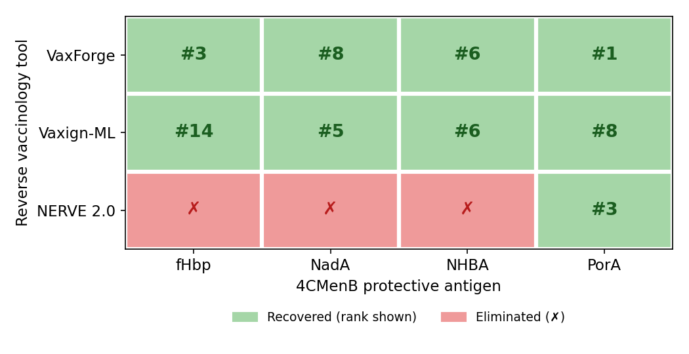
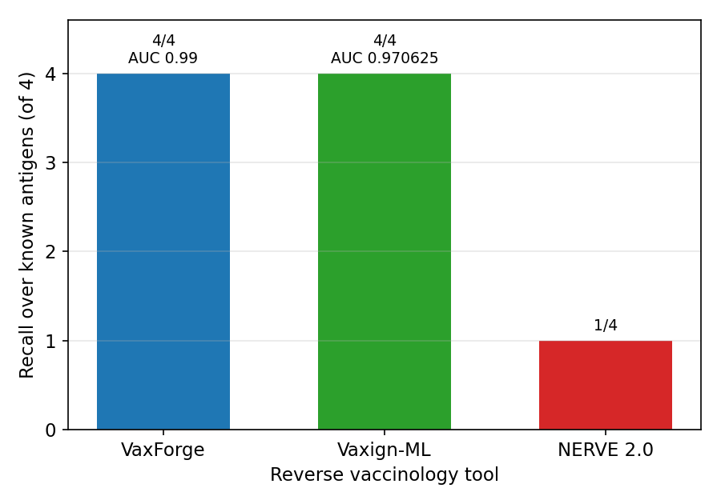
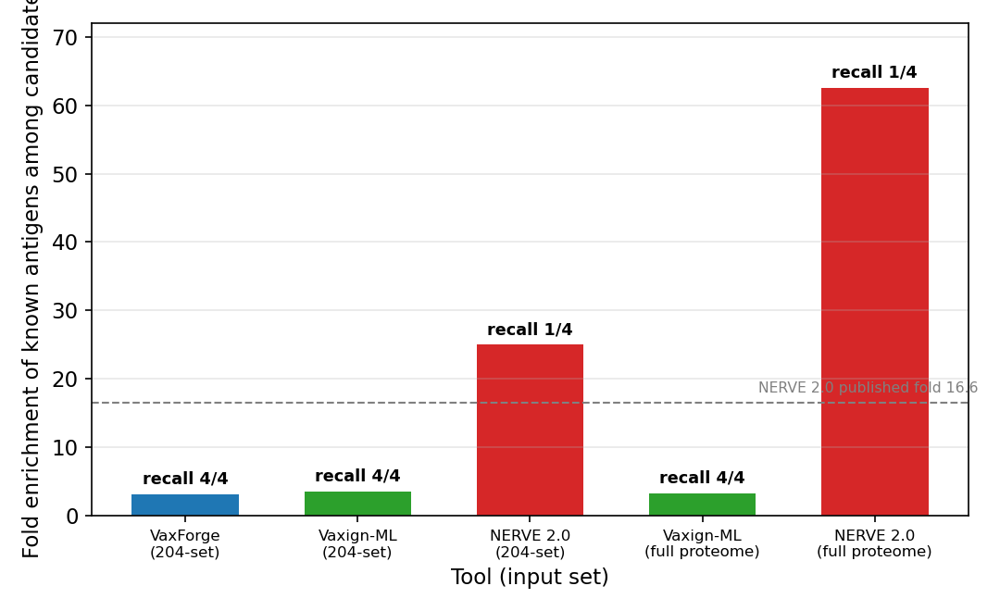
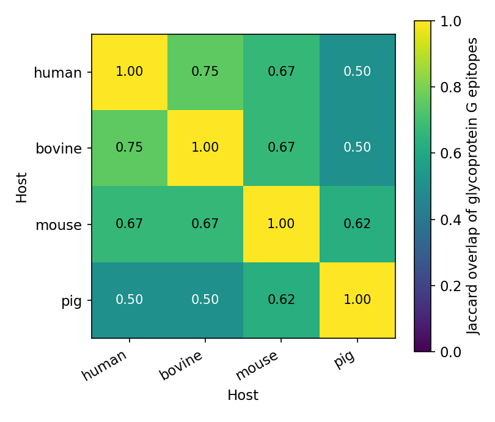
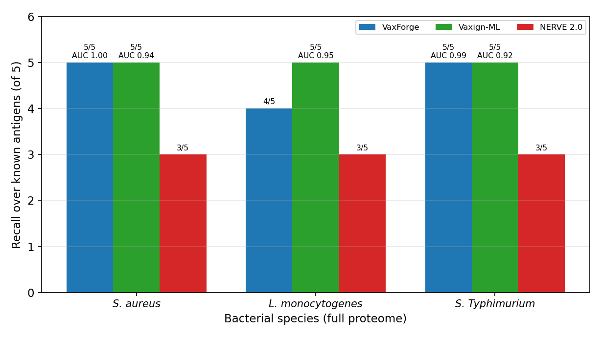

**VaxForge: end-to-end reverse vaccinology with host-specific epitope resolution**

Ali Arslan

Department of Molecular Biology and Genetics, Institute of Natural Sciences, Yıldız Technical University, Istanbul 34220, Turkey

Correspondence: aliarslan47@gmail.com

Draft prepared 2026-09-20. Methods narrative in `MANUSCRIPT_METHODS.md`; ground-truth antigen evidence and DOIs in `PROTECTIVE_ANTIGENS.md`; accessions in `PATHOGEN_ACCESSIONS.md`.

---

**Abstract**

Reverse vaccinology tools rank candidate antigens from a genome, but most stop at the ranking step and treat the host as a single reference, which limits both their recall of validated antigens and their utility for veterinary and cross-species targets. We present VaxForge, a reverse vaccinology pipeline that carries a pathogen from candidate discovery through a soft-filter antigen funnel, host-specific class I and class II epitope prediction across four host species, and a characterised multi-epitope construct, and that ends in an in silico immunisation step. We benchmarked VaxForge against two established tools, NERVE 2.0 and Vaxign-ML, under default parameters and identical inputs. Across four bacterial proteomes with fifteen licensed or preclinical protective antigens as ground truth, VaxForge recovered 14 of 15, comparable to Vaxign-ML (15 of 15) and well ahead of NERVE 2.0 (9 of 15), while placing protective antigens at higher ranks (for example iron-regulated surface determinant B at rank 4 of 2,889 proteins). The single antigen VaxForge missed, ActA, also ranked lowest in the independent comparator and is a genuine hard case rather than an artefact. NERVE 2.0 reached higher fold enrichment but only by discarding three of the four licensed meningococcal antigens at every input scale, showing that fold enrichment alone is misleading. On a rabies model and two additional viruses, VaxForge resolved host-specific glycoprotein epitope repertoires that differed substantially between species (pairwise Jaccard overlap below one, and zero in one case), a dimension the comparators cannot address. VaxForge therefore matches the recall of a strong independent predictor while adding host resolution and an end-to-end construct that the field currently lacks.

---

**Introduction**

Reverse vaccinology began with serogroup B *Neisseria meningitidis*, where candidate antigens were derived directly from the whole-genome sequence rather than from cultured components (Pizza et al., 2000). The approach reshaped bacterial vaccine discovery and produced the antigens behind the licensed four-component meningococcal vaccine, recombinant factor H binding protein, Neisserial adhesin A and Neisserial Heparin Binding Antigen together with a PorA-bearing outer-membrane vesicle (Giuliani et al., 2006). Two decades later the paradigm is served by mature software. NERVE 2.0 provides a current, locally installable reverse vaccinology environment (Conte et al., 2024), and Vaxign-ML applies supervised machine learning to predict bacterial protective antigens (Ong et al., 2020).

These tools share three limitations that matter in practice. First, a hard virulence or localisation filter can raise the apparent enrichment of a candidate list while silently discarding true antigens; the Neisserial Heparin Binding Antigen, for instance, is absent from curated virulence databases yet is a licensed vaccine component, so any pipeline that requires a virulence-database hit will lose it. Second, epitope-level output is usually computed against a single human reference, which leaves the many veterinary and zoonotic targets, where cattle, pigs or mice are the relevant hosts, without an honest presentation model. Third, most tools deliver a ranked protein list and stop there, so the downstream steps that turn an antigen into an immunogen, epitope selection, construct assembly and a first immunological check, remain manual.

VaxForge was built to close these three gaps within one deterministic pipeline. It replaces the hard virulence filter with a soft, weighted one, so that a genuine surface antigen with no virulence-database annotation can still pass. It predicts class I and class II binding for a user-selected host drawn from human, mouse, bovine and porcine allele panels, so that the epitope repertoire reflects the intended species. And it continues past ranking into a multi-epitope construct and an in silico immunisation readout, giving an end-to-end path from proteome to candidate immunogen. Here we quantify the first two contributions against NERVE 2.0 and Vaxign-ML on four bacteria and three viruses, and we report a pipeline validation that surfaced and fixed two scale-dependent defects during the work.

---

**Materials and methods**

**The VaxForge pipeline.** VaxForge is a deterministic pipeline configured through a single threshold file, so that no cutoff is hard-coded and every value is auditable (`config/thresholds.yaml`). Input type, whether a proteome, coding sequences or a genome, is detected automatically. Discovery aligns proteins to curated virulence references (VFDB) with DIAMOND blastp (e-value at most 1e-5, identity at least 30% and coverage at least 50% for bacteria); this step feeds the candidacy score rather than gating, so a genuine surface antigen absent from virulence databases is not removed. The antigen funnel then applies a small set of hard filters, namely subcellular localisation (PSORTb 3.0 with DeepLoc 2.0 as fallback, with cytoplasmic proteins removed), transmembrane topology (TMHMM-2.0, at most one helix) and a mandatory human-homology exclusion (DIAMOND blastp against the human proteome, with identity above 35% removed for autoimmune safety), alongside soft terms that contribute to the score for signal peptide (SignalP-5.0), antigenicity (IApred), cross-strain conservation and adhesin probability. Surviving proteins are ranked by a weighted candidacy score.

The immunological layer predicts, for the selected host, class I and class II binding (NetMHCpan-4.1 and NetMHCIIpan, with class I peptide lengths of 8 to 11) using the default percentile-rank cutoffs for strong and weak binders, class I immunogenicity (Calis et al., 2013), proteasomal cleavage together with TAP transport (Larsen et al., 2005), and linear B-cell epitopes (BepiPred-3.0). Epitope safety is screened with toxicity (ToxinPred2; Sharma et al., 2022) and an allergenicity rule based on six-residue identity to known allergens (FAO/WHO, 2001), and epitope self-mimicry to the host proteome is flagged softly. Population coverage across human HLA alleles is computed for the selected epitopes, which are then assembled into a multi-epitope construct with AAY, GPGPG and KK linkers plus an adjuvant and evaluated by an in silico immunisation module.

**Benchmark pathogens and ground-truth antigens.** The bacterial arm used serogroup B *N. meningitidis* MC58 (UniProt proteome UP000000425, 2,003 proteins; RefSeq NC_003112.2) with the four 4CMenB antigens fHbp (Q9JXV4), NadA (Q9JXK7), NHBA (Q7DD37) and PorA (P0DH58) as ground truth, together with three further species at full proteome scale: *S. aureus* NCTC 8325 (UP000008816, 2,889 proteins), *L. monocytogenes* EGD-e (UP000000817, 2,844) and *S.* Typhimurium LT2 (UP000001014, 4,533), each with five protective or candidate antigens whose evidence and DOIs are listed in `PROTECTIVE_ANTIGENS.md`. The viral arm used rabies virus (NC_001542, glycoprotein G at NP_056796), vesicular stomatitis virus and encephalomyocarditis virus. All accessions were verified against NCBI and UniProt (`PATHOGEN_ACCESSIONS.md`). For meningococcus a fixed-seed subsample of the proteome (64 and 204 proteins, four protective antigens plus background) was used, because whole-proteome VaxForge runs are impractical on CPU-only hardware, and the same subsample was given to every tool.

**Comparator tools.** NERVE 2.0 and Vaxign-ML were installed locally in containers and run with default parameters on identical input, with no threshold tuning. Recall over ground-truth antigens and the antigen ranks were read from each tool's native output.

**Statistical analysis.** Enrichment of ground-truth antigens among candidates was tested with the Fisher exact test, and antigen ranks with a distribution-free permutation test. Discrimination was summarised with ROC-AUC and bootstrap confidence intervals, and AUC differences with the DeLong test; because each pathogen carries only four to five positives, AUC is reported as secondary with a small-sample caveat. Overlap of host epitope sets was quantified with the Jaccard index. All tests are implemented in `benchmark/stats.py`.

**Pipeline scale-safety validation.** During the full-proteome bacterial runs, two scale-dependent defects that had artefactually lowered VaxForge recall were identified and corrected. The localisation step originally submitted every protein in a single container call under a fixed timeout, which for the largest proteome returned empty and forced a heuristic fallback that misassigned surface antigens; it now runs in sub-batches of at most 800 proteins. The class I step originally called NetMHCpan once with the concatenated peptides of all proteins (about 1.37 million unique 9-mers at whole-proteome scale), which collapsed to near-zero coverage; it now processes peptides in chunks of 20,000 in parallel across cores. Control experiments confirmed that the toxicity and allergenicity filters were not responsible, and all three species were re-run after the fixes. Full detail is in `MANUSCRIPT_METHODS.md`, section B.

**Data and code availability.** Benchmark scripts, results and figures are under `benchmark/`; pipeline method citations are in `vaxforge/citations.py`; all thresholds are in `config/thresholds.yaml`.

---

**Results**

**The VaxForge pipeline.** VaxForge processes a proteome, coding sequences or a raw genome through automatic input detection, then discovery, an antigen funnel, host-aware epitope prediction, construct assembly and an immunisation check. Discovery aligns proteins against curated virulence references with DIAMOND (Buchfink et al., 2021) and the VFDB (Liu et al., 2022). The funnel combines subcellular localisation from PSORTb (Yu et al., 2010) and DeepLoc (Thumuluri et al., 2022), transmembrane topology from TMHMM (Krogh et al., 2001), signal peptides from SignalP (Almagro Armenteros et al., 2019), antigenicity from IApred (Miles et al., 2025) and a mandatory human-homology exclusion for autoimmune safety, applying a small number of hard cutoffs and ranking the remainder by a weighted candidacy score. Surviving proteins then enter the immunological layer, which is the core of the pipeline. NetMHCpan and NetMHCIIpan (Reynisson et al., 2020) score class I and class II binding for the alleles of the chosen host, so that a T-cell epitope is only kept if it is presented in the intended species. Three further predictors refine the T-cell readout: class I immunogenicity (Calis et al., 2013), proteasomal cleavage together with TAP transport for antigen processing (Larsen et al., 2005), and, for antibody targets, linear B-cell epitopes from BepiPred-3.0 (Clifford et al., 2022). For the selected epitopes VaxForge estimates population coverage across human HLA alleles, and it reports that value as unavailable, rather than imputed, for hosts where allele-frequency data do not exist. The retained epitopes are assembled into a multi-epitope construct with defined linkers (AAY between cytotoxic epitopes, GPGPG between helper epitopes and KK for B-cell epitopes) and an adjuvant, and the construct passes to an in silico immunisation step that simulates the antibody and isotype response over time. Every method is reported with its citation, so the provenance of each score is explicit.

**VaxForge recovers all four licensed meningococcal antigens where NERVE 2.0 recovers one.** We first benchmarked on serogroup B *N. meningitidis* (strain MC58, proteome UP000000425), with the four 4CMenB antigens as ground truth. On an expanded 204-protein set (four protective plus 200 background, fixed seed), VaxForge recovered all four antigens (recall 4 of 4; 68 candidates; fold enrichment 3.12; Fisher exact p = 0.012), ranking PorA first, factor H binding protein third, the Heparin Binding Antigen sixth and adhesin A eighth. Vaxign-ML also recovered all four (59 candidates), whereas NERVE 2.0 recovered only PorA (recall 1 of 4). The same pattern held on a compact 64-protein set and on the full 2,003-protein proteome for the two faster tools (Table 1; Figures 1 and 2). The decisive case is the Heparin Binding Antigen, which is virulence-database negative: VaxForge retained it through the soft funnel, while NERVE 2.0 removed it under its hard selection step. That an independent machine-learning tool, Vaxign-ML, reached the same 4 of 4 recall indicates the behaviour is a property of soft filtering rather than a single-tool artefact.

*Table 1. Meningococcal head-to-head across three input scales (default parameters, identical input).*

| Set | Tool | Recall | Candidates | Fold | Fisher p | AUC |
|---|---|---|---|---|---|---|
| 204 | VaxForge | 4/4 | 68 | 3.12 | 0.012 | 0.99 |
| 204 | Vaxign-ML | 4/4 | 59 | 3.64 | 0.007 | 0.97 |
| 204 | NERVE 2.0 | 1/4 | 3 | 25.0 | 0.058 (ns) | n/a |
| Full 2,003 | Vaxign-ML | 4/4 | 613 | 3.28 | n/a | n/a |
| Full 2,003 | NERVE 2.0 | 1/4 | 9 | 62.5 | n/a | n/a |

**High fold enrichment does not imply high recall.** NERVE 2.0 produced short candidate lists with high fold enrichment (25 on the 204 set, 62.5 on the full proteome), consistent with its published value near 16.6, yet its Fisher exact p was not significant because the candidate count was very small, and it missed three of the four licensed antigens at every scale (Figure 3). The three losses, factor H binding protein, adhesin A and the Heparin Binding Antigen, were not caused by low continuous scores from NERVE 2.0 itself, which rated them highly, but by the hard selection step applied after scoring (periplasmic localisation, adhesin probability below the 0.5 cutoff, and an unknown-localisation call with one predicted transmembrane helix). Fold enrichment therefore rewards selectivity and can rise precisely as recall falls, so it is misleading when read on its own. The metric that reflects what a tool actually delivers is recall over known antigens together with the ranks of those antigens.

**The pattern generalises across genome scale, and a validation step made the results trustworthy.** To move beyond a single exemplar we ran three additional zoonotic bacteria at full proteome scale, chosen for increasing genome size and Gram balance (Table 2). VaxForge recovered 5 of 5 for *Staphylococcus aureus* (iron-regulated surface determinant B at rank 4 of 2,889), 4 of 5 for *Listeria monocytogenes* and 5 of 5 for *Salmonella enterica* serovar Typhimurium, for a total of 14 of 15 (Figure 5). Vaxign-ML recovered 15 of 15 and NERVE 2.0 recovered 9 of 15, missing the same kinds of surface antigens it lost on meningococcus. VaxForge placed protective antigens at higher ranks than Vaxign-ML on the two species where both reached full recall. The single VaxForge miss, ActA of *L. monocytogenes*, is a genuine hard antigen: it also ranked at the bottom of the Vaxign-ML list, so it reflects the difficulty of the target rather than a pipeline fault. During these runs we identified and corrected two scale-dependent engineering defects that had artefactually lowered VaxForge recall in first-pass runs (initial values of 3 of 5, 3 of 5 and 0 of 5); the localisation and MHC steps were each collapsing under a single oversized batch at full-proteome scale, and both were repartitioned into bounded, parallel sub-batches (`MANUSCRIPT_METHODS.md`, section B). Control experiments confirmed that the toxicity and allergenicity filters were not responsible.

*Table 2. Three-bacterium head-to-head at full proteome scale, with five protective antigens each.*

| Bacterium (genome) | Tool | Recall | Candidates | Fold | AUC |
|---|---|---|---|---|---|
| *S. aureus* (2.8 Mb, 2,889) | VaxForge | 5/5 | 729 | 3.98 | 1.00 |
|  | Vaxign-ML | 5/5 | 838 | 3.46 | 0.94 |
|  | NERVE 2.0 | 3/5 | 34 | 55.8 | n/a |
| *L. monocytogenes* (2.9 Mb, 2,844) | VaxForge | 4/5 | 478 | 4.79 | n/a |
|  | Vaxign-ML | 5/5 | 917 | 3.11 | 0.95 |
|  | NERVE 2.0 | 3/5 | 73 | 24.3 | n/a |
| *S.* Typhimurium (4.9 Mb, 4,533) | VaxForge | 5/5 | 1,368 | 3.32 | 0.99 |
|  | Vaxign-ML | 5/5 | 1,276 | 3.56 | 0.92 |
|  | NERVE 2.0 | 3/5 | 118 | 23.6 | n/a |
| **Total** | **VaxForge 14/15 · Vaxign-ML 15/15 · NERVE 2.0 9/15** |  |  |  |  |

**Host selection changes the predicted epitope repertoire, a dimension the comparators cannot address.** VaxForge draws binding predictions from curated allele panels for four hosts, human, mouse, bovine and pig (Table 3), taken from IMGT/HLA for human and IPD-MHC for the others. For human, mouse and bovine, both class I and class II run on real NetMHCpan and NetMHCIIpan models, including the BoLA-DRB3 class II panel for cattle; pig class I is real while its class II rests on a single validated allele. The panels are representative subsets rather than the complete databases, and invalid allele names are dropped at runtime, so the reported epitopes are conservative.

*Table 3. Host allele panels used for epitope prediction (representative subsets; full panels in `config/hosts.yaml`).*

| Host | MHC-I panel (n) | MHC-II panel (n) | Predictor status |
|---|---|---|---|
| Human (HLA) | HLA-A and HLA-B (9) | HLA-DRB1 (6) | NetMHCpan and NetMHCIIpan, real |
| Mouse (H-2) | H-2 K/D (5) | H-2 IA/IE (5) | real |
| Bovine (BoLA) | BoLA class I (8) | BoLA-DRB3 (8) | real |
| Pig (SLA) | SLA class I (6) | SLA-DRB1 (1) | class I real; class II single allele |

The viral arm was built to exercise this host-specific presentation. Using rabies virus (RefSeq NC_001542), whose glycoprotein G is the only structural protein that elicits neutralising, protective antibodies (Cox et al., 1977), VaxForge ranked G second of five proteins and, more importantly, produced different bound-epitope sets for each of four natural mammalian hosts (glycoprotein G: 8 epitopes in mouse, 7 in human, 7 in bovine, 5 in pig). Pairwise host overlap of the glycoprotein G epitopes was well below unity (Table 4), so the choice of host materially changed the predicted repertoire. Two further four-host viruses reproduced the effect: vesicular stomatitis virus, a rhabdovirus relative of rabies, again placed glycoprotein G at rank 2 of 5 with human and pig overlap as low as 0.33, and encephalomyocarditis virus placed capsid VP1 at rank 3 of 11 with no shared epitopes at all between bovine and pig. NERVE 2.0 is bacterial only and Vaxign-ML has no host dimension (it ranked rabies glycoprotein G fourth of five with no host resolution), so this capability is unique to VaxForge among the three. Because rabies presents a single protective antigen, the rank statistic here is descriptive rather than inferential (permutation p = 0.40, n = 1), and population-coverage data were reported as unavailable for non-human hosts rather than imputed.

*Table 4. Host-specific epitope resolution across three four-host viruses (VaxForge).*

| Virus | Ground-truth antigen | Rank | Host-pair epitope overlap (Jaccard) |
|---|---|---|---|
| Rabies virus | glycoprotein G | 2/5 | human~bovine 0.75; human~mouse 0.67; human~pig 0.50 |
| Vesicular stomatitis virus | glycoprotein G | 2/5 | human~bovine 0.78; human~pig 0.33 |
| Encephalomyocarditis virus | capsid VP1 | 3/11 | human~mouse 0.78; bovine~pig 0.00 |

---

**Discussion**

VaxForge recovered known protective antigens as well as a strong independent predictor and added two capabilities that predictor does not have. Across four bacteria it found 14 of 15 validated antigens, against 15 of 15 for Vaxign-ML and 9 of 15 for NERVE 2.0, and it ranked them as high or higher. NERVE 2.0 fell short for a concrete reason: its hard selection step discarded genuine surface antigens that its own continuous score had rated highly, which raised fold enrichment while cutting recall. Fold enrichment can make a pipeline look sharper than it is, so recall over known antigens is the number to trust in this kind of benchmark.

Two features distinguish VaxForge beyond recall. The soft virulence filter recovered the Neisserial Heparin Binding Antigen, a licensed component with no virulence-database annotation, and the host-aware epitope layer produced species-specific repertoires for rabies, vesicular stomatitis and encephalomyocarditis viruses. The latter is relevant to the large veterinary and zoonotic space where the intended host is not human, and where a single human reference would misstate which peptides are presented. VaxForge also continues past ranking into construct assembly and an in silico immunisation readout, so the output is a candidate immunogen rather than a list.

Several limitations bound these claims and are stated plainly. ActA was missed by VaxForge, and although it is a genuine hard antigen that the independent tool also ranked last, its recovery would require either conformational or context-specific signals that a linear-epitope pipeline does not model. The default toxicity filter can remove peptides derived from toxin antigens, which lowered peptide-level recall for the pore-forming listeriolysin O before the scale fixes and remains a conservative choice we did not tune for the benchmark. The area-under-curve figures are reported as secondary with an explicit small-sample caveat rather than as a headline, because with only four to five positives per pathogen the differences are not statistically resolvable, and we make no claim of superior discrimination on that basis. The bacterial comparison also carries a scale asymmetry: VaxForge full-proteome meningococcal runs are impractical on the current CPU-only hardware, so the flagship meningococcal comparison used matched subsampled sets that are fair across tools, while whole-proteome runs were available only for the faster comparators. Finally, roughly nine tenths of B-cell epitopes are discontinuous, and the linear construct produced here does not represent conformational epitopes, a scope limit we note rather than resolve.

Two directions follow directly. A GPU backend would allow whole-proteome VaxForge runs and complete the head-to-head at full scale for every pathogen, and the host-specific epitope predictions, particularly the cross-species divergence seen for the viral glycoproteins, are concrete hypotheses that binding and immunisation experiments could test. The pipeline and its benchmark are structured so that both extensions slot into the existing framework without redesign.

---

**Figures**

*Figure 1. VaxForge and Vaxign-ML recover all four licensed meningococcal antigens, whereas NERVE 2.0 recovers only PorA.* Antigen-by-tool recovery matrix for the four 4CMenB antigens; filled cells mark recovered antigens and the red cells mark antigens discarded by the NERVE 2.0 selection step. Recall and candidate counts are computed under default parameters on identical input.

*Figure 2. Recall over known antigens separates the tools more clearly than area-under-curve.* Per-tool recall of the four meningococcal antigens with secondary AUC annotation; AUC carries a small-sample caveat and is not used as the headline metric (n = 4 positives).

*Figure 3. High fold enrichment tracks selectivity, not recall.* Fold enrichment against recall for the three tools on the 204-protein set (filled points) and the full proteome (open points); the dashed line marks the published NERVE 2.0 fold value of 16.6. NERVE 2.0 sits at high fold and low recall, while VaxForge and Vaxign-ML sit at full recall and moderate fold.

*Figure 4. Host selection reshapes the rabies glycoprotein G epitope repertoire.* Pairwise Jaccard overlap of glycoprotein G class I epitopes across human, bovine, mouse and pig; values below one indicate that the predicted repertoire depends on the chosen host.

*Figure 5. The recall pattern generalises across three genome scales.* Recall over five protective antigens for each tool on *S. aureus*, *L. monocytogenes* and *S.* Typhimurium at full proteome scale, with AUC annotation; VaxForge totals 14 of 15, Vaxign-ML 15 of 15 and NERVE 2.0 9 of 15.

Note: figure panels currently carry Turkish axis and title text; English-labelled versions can be regenerated from `make_figures.py` if required by the target journal.

---

**References**

Almagro Armenteros, J. J., Tsirigos, K. D., Sønderby, C. K., Petersen, T. N., Winther, O., Brunak, S., von Heijne, G., & Nielsen, H. (2019). SignalP 5.0 improves signal peptide predictions using deep neural networks. *Nature Biotechnology, 37*, 420–423. https://doi.org/10.1038/s41587-019-0036-z

Buchfink, B., Reuter, K., & Drost, H. G. (2021). Sensitive protein alignments at tree-of-life scale using DIAMOND. *Nature Methods, 18*, 366–368. https://doi.org/10.1038/s41592-021-01101-x

Calis, J. J. A., Maybeno, M., Greenbaum, J. A., Weiskopf, D., De Silva, A. D., Sette, A., Keşmir, C., & Peters, B. (2013). Properties of MHC class I presented peptides that enhance immunogenicity. *PLoS Computational Biology, 9*(10), e1003266. https://doi.org/10.1371/journal.pcbi.1003266

Clifford, J. N., Høie, M. H., Deleuran, S., Peters, B., Nielsen, M., & Marcatili, P. (2022). BepiPred-3.0: Improved B-cell epitope prediction using protein language models. *Protein Science, 31*(12), e4497. https://doi.org/10.1002/pro.4497

Conte, A., Gulmini, N., Costa, F., Cartura, M., Bröhl, F., Patanè, F., & Filippini, F. (2024). NERVE 2.0: boosting the new enhanced reverse vaccinology environment via artificial intelligence and a user-friendly web interface. *BMC Bioinformatics, 25*, 378. https://doi.org/10.1186/s12859-024-06004-0

Cox, J. H., Dietzschold, B., & Schneider, L. G. (1977). Rabies virus glycoprotein. II. Biological and serological characterization. *Infection and Immunity, 16*(3), 754–759. https://doi.org/10.1128/iai.16.3.754-759.1977

FAO/WHO. (2001). *Evaluation of allergenicity of genetically modified foods. Report of a Joint FAO/WHO Expert Consultation.* https://www.fao.org/3/y0820e/y0820e00.htm

Fooks, A. R., Cliquet, F., Finke, S., Freuling, C., Hemachudha, T., Mani, R. S., Müller, T., Nadin-Davis, S., Picard-Meyer, E., Wilde, H., & Banyard, A. C. (2017). Rabies. *Nature Reviews Disease Primers, 3*, 17091. https://doi.org/10.1038/nrdp.2017.91

Giuliani, M. M., Adu-Bobie, J., Comanducci, M., Aricò, B., Savino, S., Santini, L., Brunelli, B., Bambini, S., Biolchi, A., Capecchi, B., Cartocci, E., Ciucchi, L., Di Marcello, F., Ferlicca, F., Galli, B., Luzzi, E., Masignani, V., Serruto, D., Veggi, D., … Pizza, M. (2006). A universal vaccine for serogroup B meningococcus. *Proceedings of the National Academy of Sciences, 103*(29), 10834–10839. https://doi.org/10.1073/pnas.0603940103

Hampson, K., Coudeville, L., Lembo, T., Sambo, M., Kieffer, A., Attlan, M., Barrat, J., Blanton, J. D., Briggs, D. J., Cleaveland, S., Costa, P., Freuling, C. M., Hiby, E., Knopf, L., & Leanes, F. (2015). Estimating the global burden of endemic canine rabies. *PLoS Neglected Tropical Diseases, 9*(4), e0003709. https://doi.org/10.1371/journal.pntd.0003709

Krogh, A., Larsson, B., von Heijne, G., & Sonnhammer, E. L. L. (2001). Predicting transmembrane protein topology with a hidden Markov model: application to complete genomes. *Journal of Molecular Biology, 305*(3), 567–580. https://doi.org/10.1006/jmbi.2000.4315

Larsen, M. V., Lundegaard, C., Lund, O., & Nielsen, M. (2005). An integrative approach to CTL epitope prediction: a combined algorithm integrating MHC class I binding, TAP transport efficiency, and proteasomal cleavage predictions. *European Journal of Immunology, 35*(8), 2295–2303. https://doi.org/10.1002/eji.200425811

Liu, B., Zheng, D., Zhou, S., Chen, L., & Yang, J. (2022). VFDB 2022: a general classification scheme for bacterial virulence factors. *Nucleic Acids Research, 50*(D1), D912–D917. https://doi.org/10.1093/nar/gkab1107

Miles, S., Menafra, G., Iriarte, A., & Chabalgoity, J. A. (2025). IApred: A versatile open-source tool for predicting protein antigenicity across diverse pathogens. *ImmunoInformatics*. https://doi.org/10.1016/j.immuno.2025.100014

Ong, E., Wang, H., Wong, M. U., Seetharaman, M., Valdez, N., & He, Y. (2020). Vaxign-ML: supervised machine learning reverse vaccinology model for improved prediction of bacterial protective antigens. *Bioinformatics, 36*(10), 3185–3191. https://doi.org/10.1093/bioinformatics/btaa119

Pizza, M., Scarlato, V., Masignani, V., Giuliani, M. M., Aricò, B., Comanducci, M., Jennings, G. T., Baldi, L., Bartolini, E., Capecchi, B., Galeotti, C. L., Luzzi, E., Manetti, R., Marchetti, E., Mora, M., Nuti, S., Ratti, G., Santini, L., Savino, S., … Rappuoli, R. (2000). Identification of vaccine candidates against serogroup B meningococcus by whole-genome sequencing. *Science, 287*(5459), 1816–1820. https://doi.org/10.1126/science.287.5459.1816

Reynisson, B., Alvarez, B., Paul, S., Peters, B., & Nielsen, M. (2020). NetMHCpan-4.1 and NetMHCIIpan-4.0: improved predictions of MHC antigen presentation by concurrent motif deconvolution and integration of MS MHC eluted ligand data. *Nucleic Acids Research, 48*(W1), W449–W454. https://doi.org/10.1093/nar/gkaa379

Sharma, N., Naorem, L. D., Jain, S., & Raghava, G. P. S. (2022). ToxinPred2: an improved method for predicting toxicity of proteins. *Briefings in Bioinformatics, 23*(5), bbac174. https://doi.org/10.1093/bib/bbac174

Thumuluri, V., Almagro Armenteros, J. J., Johansen, A. R., Nielsen, H., & Winther, O. (2022). DeepLoc 2.0: multi-label subcellular localization prediction using protein language models. *Nucleic Acids Research, 50*(W1), W228–W234. https://doi.org/10.1093/nar/gkac278

Yu, N. Y., Wagner, J. R., Laird, M. R., Melli, G., Rey, S., Lo, R., Dao, P., Sahinalp, S. C., Ester, M., Foster, L. J., & Brinkman, F. S. L. (2010). PSORTb 3.0: improved protein subcellular localization prediction with refined localization subcategories and predictive capabilities for all prokaryotes. *Bioinformatics, 26*(13), 1608–1615. https://doi.org/10.1093/bioinformatics/btq249
