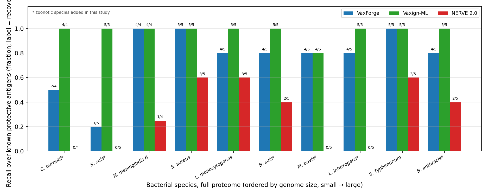
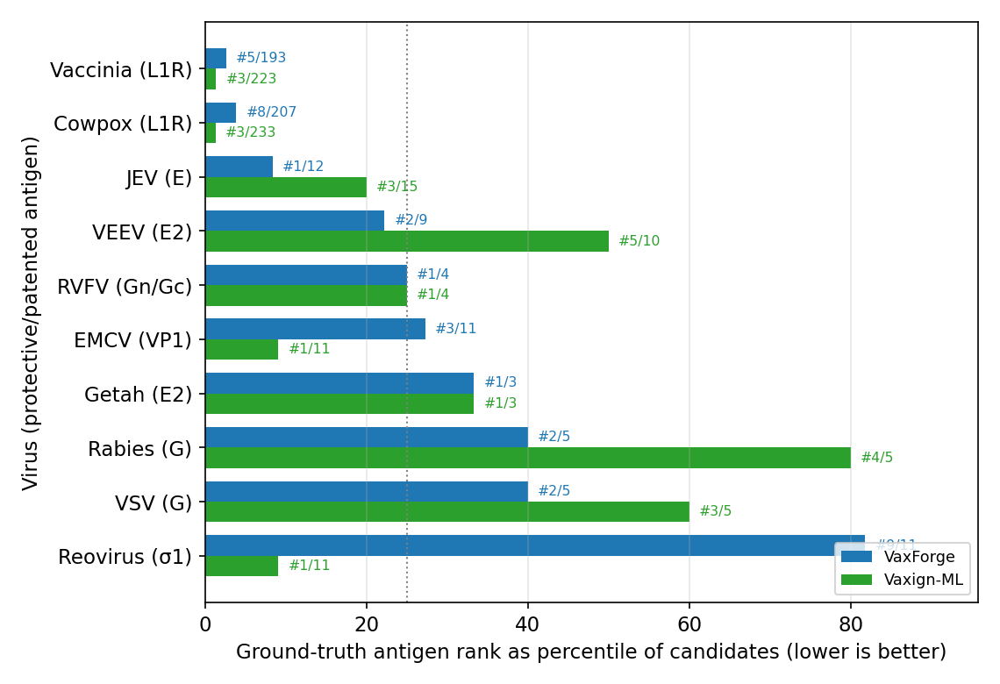
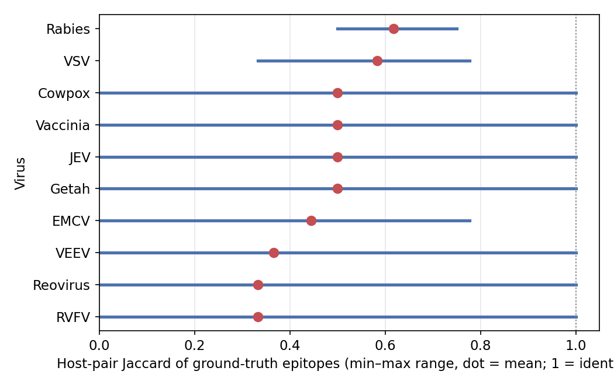
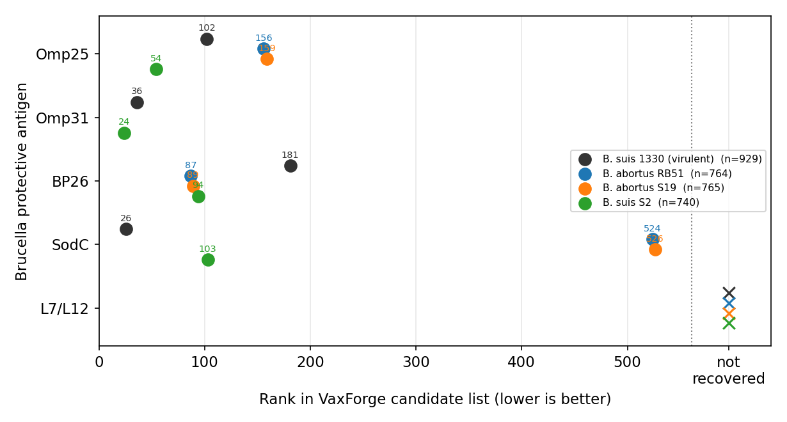
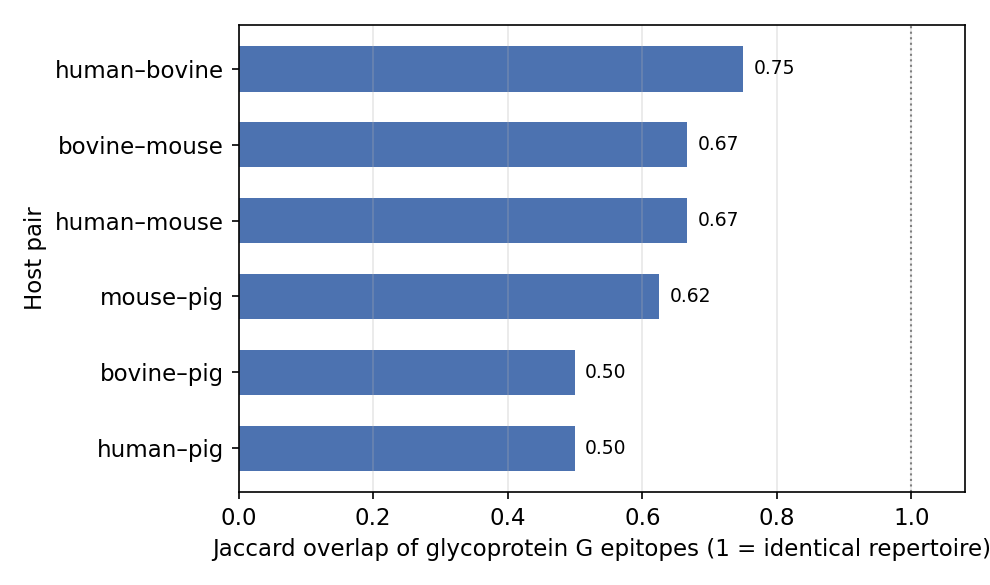

**Konak çözünürlüklü ters aşı bilişimi: VaxForge, tam-proteom antijen keşfini türe özgü epitop tahmini ve konstrukt kurulumuyla birleştirir**

Ali Arslan

Department of Molecular Biology and Genetics, Institute of Natural Sciences, Yıldız Technical University, Istanbul 34220, Turkey

Yazışma: aliarslan47@gmail.com

Taslak 2026-10-10'da yeniden kurgulandı (2026-09-20 taslağının yerini alır). Genişletilmiş yöntem anlatısı `MANUSCRIPT_METHODS.md`'de; ground-truth antijen kanıtı ve DOI'ler `PROTECTIVE_ANTIGENS.md`'de; aksesyonlar `PATHOGEN_ACCESSIONS.md`'de; antijen başına kaçma atfı `MISS_ATTRIBUTION.md`'de. Bu belge, İngilizce sürümün (`MANUSCRIPT.md`) Türkçe karşılığıdır. Şekil dosya eşlemesi: Şekil 1 `fig1_antigen_recovery`, Şekil 2 `fig2_recall_bar`, Şekil 3 `fig3_fold_vs_recall`, Şekil 4 `fig4_bacteria_panel`, Şekil 5 `fig6_virus_antigen_rank`, Şekil 6 `fig7_virus_multihost`, Ek Şekil 1 `figS1_brucella_vaccine`, Ek Şekil 2 `fig5_multihost_jaccard`.

---

**Özet**

Ters aşı bilişimi, bir patojen genomundan aday antijenleri sıralar; ancak yaygın kullanılan araçlar sıralama basamağında durur ve konağı tek bir insan referansı olarak modeller. Bu, küresel aşı yükünün büyük bölümünü taşıyan veteriner ve zoonotik hedefler için araçların değerini sınırlar. Burada VaxForge'u tanıtıyoruz: bir proteomu yumuşak-filtreli antijen hunisinden, dört memeli konak için derlenmiş allel panellerine karşı sınıf I ve sınıf II epitop tahmininden, çok-epitoplu konstrukt kurulumundan ve in silico immünizasyon okumasından geçiren deterministik bir hat. Varsayılan parametrelerle, NERVE 2.0 ve Vaxign-ML'e karşı on bakteride tam-proteom ölçeğinde kıyaslandığında VaxForge, bağımsız olarak doğrulanmış 48 koruyucu antijenin 37'sini geri getirdi; Vaxign-ML 47'sini, NERVE 2.0 14'ünü getirdi. Ruhsatlı dört 4CMenB antijeninin dördünü de geri getirdi; NERVE 2.0 yalnız birini. Ardından kaçan her antijeni belirli bir hat basamağına atfettik. On bir kaybın altısı, zorunlu konak-homoloji filtresi tarafından elenmişti ve ilişki tek yönde mutlaktır: geri getirilen hiçbir antijen insan homologu taşımıyor (0/37; Fisher kesin testi p = 3,8 × 10⁻⁵). Dolayısıyla recall farkı, ayırt etme başarısızlığı değil, ölçülebilir bir güvenlik-duyarlılık ödünleşmesidir. Ayrıca genelleme kıyasının 44 ground-truth antijeninin 26'sının (%59) gözetimli karşılaştırma aracının eğitim kaynağı olan Protegen'deki kayıtlarla en az %90 kimlikte olduğunu ve o aracın sıralama avantajının orada yoğunlaştığını gösteriyoruz: medyan sırası, kendi eğitim etiketi olan antijenlerde 70 iken bu kaynaktan bağımsız yedi antijende 214'e kötüleşiyor ve bunların hiçbirini ilk yirmisine koyamıyor; VaxForge yedinin üçünü koyuyor. On virüste koruyucu antijenin tahmin edilen epitop repertuarı her durumda konak türüne göre değişti ve birkaç virüste hiç epitop paylaşmayan konak çiftleri çıktı; bu, karşılaştırılan iki aracın da çözemediği bir boyuttur.

---

**Giriş**

Ters aşı bilişimi, aday antijenlerin kültür bileşenlerinden değil doğrudan tam-genom dizisinden türetildiği serogrup B *Neisseria meningitidis* çalışmasıyla başladı (Pizza ve ark., 2000) ve ruhsatlı dört bileşenli meningokok aşısının arkasındaki antijenleri üretti: faktör H bağlayıcı protein, Neisserial adezin A ve Neisserial Heparin Bağlayıcı Antijen ile PorA taşıyan dış-membran vezikülü (Giuliani ve ark., 2006). Yirmi yıl sonra yaklaşım, iki tasarım felsefesine yayılan olgun yazılımlarla hizmet görüyor (Goodswen ve ark., 2023). NERVE 2.0 gibi filtre-tabanlı ortamlar proteinleri lokalizasyon, topoloji ve adezin olasılığı üzerindeki eşik dizisinden geçirir (Conte ve ark., 2024). Sınıflandırıcı-tabanlı yöntemler sekansı doğrudan skorlar: Vaxign-ML derlenmiş betimleyicilere gradyan artırma uygular (Ong ve ark., 2020) ve güncel nesil bu betimleyicileri protein dil modeli gömülerine bırakır — Vaxign-DL (Chen ve ark., 2024), Podda ve ark.'nın (2025) betimleyicisiz ESM-2 hattı ve geometrik derin öğrenmeyi ekleyip daha önce tanımlanmamış bir ortopoksvirüs antijenini in vivo doğrulayan sekans-artı-yapı çerçevesi PLGDL (Zai ve ark., 2025) gibi.

Bu ilerleme neredeyse tümüyle tek bir soruda yoğunlaştı: bir modelin koruyucu antijenleri proteomun kalanından ne kadar doğru ayırdığı. Üç pratik eksik büyük ölçüde el değmemiş kaldı. Birincisi, sert bir virülans veya lokalizasyon filtresi aday listesinin görünür zenginleşmesini yükseltirken gerçek antijenleri sessizce atabilir; Neisserial Heparin Bağlayıcı Antijen bunun yerleşik örneğidir: derlenmiş virülans veri tabanlarında yoktur ama ruhsatlı bir aşı bileşenidir. İkincisi, epitop düzeyindeki çıktı tek bir insan referansına karşı hesaplanır; bu, NetMHCpan ve NetMHCIIpan birçok insan-dışı alleli desteklemesine karşın (Reynisson ve ark., 2020) sığır, domuz ve fare hedeflerini dürüst bir sunum modeli olmadan bırakır. Üçüncüsü, hatlar sıralanmış bir protein listesinde biter; epitop seçimi, konstrukt kurulumu ve ilk immünolojik denetim elde kalır. Antijenleri daha doğru sıralayan bir sınıflandırıcı bu üçünden hiçbirini kapatmaz.

VaxForge bunları tek bir deterministik hat içinde kapatmak için kuruldu. Sert virülans kapısını yumuşak, skor-ağırlıklı bir terimle değiştirir; böylece virülans anotasyonu olmayan gerçek bir yüzey antijeni yine geçebilir. İnsan, fare, sığır ve domuz konakları için derlenmiş allel panellerine karşı sınıf I ve sınıf II bağlanmayı tahmin eder. Ve sıralamanın ötesine, karakterize edilmiş çok-epitoplu bir konstrukta ve in silico immünizasyon okumasına geçer. Burada davranışını varsayılan parametreler altında on bakteri ve on virüste NERVE 2.0 ve Vaxign-ML'e karşı nicelendiriyoruz, kaçırdığı her antijeni yalnız recall bildirmek yerine belirli bir hat basamağına atfediyoruz ve saf bir sınıflandırıcıya karşı oluşan recall farkının, etkisini ölçebildiğimiz kasıtlı bir güvenlik filtresi tarafından domine edildiğini gösteriyoruz.

---

**Sonuçlar**

**VaxForge, yumuşak-filtreli bir huniyi konak çözünürlüklü bir immünolojik katmanla birleştirir.** VaxForge girdisinin proteom, kodlayan diziler ya da ham genom olup olmadığını saptar; ardından keşif, antijen hunisi, konak-duyarlı epitop tahmini, konstrukt kurulumu ve immünizasyon denetimini koşar ve her eşiği tek bir yapılandırma dosyasından okur, yani hiçbir eşik koda gömülü değildir. Huni üç sert filtre uygular — hücre-altı lokalizasyon, transmembran topoloji ve konak homolojisi — ve virülans kanıtını, sinyal peptitlerini, antijenisiteyi, suşlar-arası korunmayı ve adezin olasılığını yumuşak, skor-ağırlıklı terimler olarak ele alır. Hayatta kalan proteinler, hattı ayrıştıran kısma girer: sınıf I ve sınıf II bağlanma seçilen konağın allelleri için tahmin edilir, yani bir T-hücre epitobu ancak hedeflenen türde sunuluyorsa tutulur; üç ek tahminci okumayı sınıf I immünojenisitesi, proteazomal kesim ile TAP taşınması ve lineer B-hücre epitopları üzerinden incelir. Tutulan epitoplar tanımlı bağlayıcılar ve bir adjuvanla, fizikokimyasal olarak karakterize edilip immünizasyon basamağına geçirilen bir konstrukta birleştirilir. Popülasyon kapsaması insan HLA için hesaplanır ve allel-frekans verisi olmayan konaklarda atfedilmek yerine "veri yok" olarak bildirilir. Tablo 1, ortaya çıkan yetenek yüzeyini iki karşılaştırma aracının yanına koyar.

**Tablo 1.** Karşılaştırılan üç aracın girdileri, çıktıları ve yetenekleri (✓ var, ✗ yok). Karşılaştırma araçlarının yetenekleri kendi kaynak yayınlarında tarif edildiği gibi verilmiştir (NERVE 2.0, Conte ve ark., 2024; Vaxign-ML, Ong ve ark., 2020).

| Yetenek | VaxForge | NERVE 2.0 | Vaxign-ML |
|---|---|---|---|
| Girdi | proteom, CDS veya genom (oto-saptama) | bakteri proteomu + Gram tipi | bakteri protein proteomu |
| Desteklenen patojenler | bakteri ve virüs | yalnız bakteri | bakteri (virüsler yayında tarif edilmemiş) |
| Yaklaşım | kural + ML hibrit huni, immünolojik katmanlı | AI modüllü kural-tabanlı modüler hat | gözetimli ML sınıflandırıcı (XGBoost) |
| Antijen sıralama | ✓ ağırlıklı adaylık skoru | ✓ Select + skor | ✓ protejenisite skoru |
| Otoimmünite (konak-homoloji) filtresi | ✓ insan, zorunlu | ✓ insan + opsiyonel fare | ✗ |
| Virülans-negatif antijenleri tutar | ✓ yumuşak huni | ✗ sert Select eler | ✓ skor-tabanlı |
| T-hücre / MHC epitop tahmini | ✓ NetMHCpan/II + işlenme + immünojenisite | ✓ MHC-I/II, lineer, insan HLA süpertipleri | ✗ |
| B-hücre epitop tahmini | ✓ BepiPred-3.0 | ✗ | ✗ |
| Konak-özgü MHC allel seçimi | ✓ insan/fare/sığır/domuz | kısmi (epitoplar yalnız insan HLA; güvenlik için fare) | ✗ |
| Popülasyon kapsaması | ✓ insan HLA (diğer konaklarda "veri yok") | ✓ insan HLA | ✗ |
| Çok-epitoplu konstrukt | ✓ bağlayıcılar + adjuvan | ✗ | ✗ |
| In silico immünizasyon | ✓ | ✗ | ✗ |
| Birincil çıktı | sıralı antijenler + konak-özgü epitoplar + konstrukt + immünizasyon | PVC kısa listesi + T-hücre epitopları / popülasyon kapsaması | protein başına protejenisite skoru |

**VaxForge, ruhsatlı dört meningokok antijeninin dördünü de geri getirirken NERVE 2.0 birini getirir.** İlk kıyası *N. meningitidis* MC58 üzerinde, dört 4CMenB antijenini ground-truth alarak yaptık. Genişletilmiş 204-protein setinde (dört koruyucu artı 200 fon, sabit tohum) VaxForge dördünü de geri getirdi (68 aday; fold-zenginleşme 3,12; Fisher kesin testi p = 0,012); PorA'yı birinci, faktör H bağlayıcı proteini üçüncü, Heparin Bağlayıcı Antijeni altıncı ve adezin A'yı sekizinci sıraya koydu. Vaxign-ML de 59 adaydan dördünü getirdi; NERVE 2.0 yalnız PorA'yı. Aynı desen 64-protein setinde ve iki hızlı araç için tam 2.003-protein proteomunda korundu (Tablo 2; Şekil 1 ve 2). Belirleyici vaka, virülans-veritabanı-negatif olan Heparin Bağlayıcı Antijendir: VaxForge onu yumuşak huniden geçirdi, NERVE 2.0 ise sert seçim basamağında eledi. Bağımsız bir sınıflandırıcının da aynı 4/4'e ulaşması, bunun tek-araç yapaylığı değil yumuşak filtrelemenin bir özelliği olduğunu gösterir.

**Tablo 2.** Üç girdi ölçeğinde meningokok baş-başa karşılaştırması (varsayılan parametreler, özdeş girdi).

| Set | Araç | Recall | Aday | Fold | Fisher p | AUC |
|---|---|---|---|---|---|---|
| 204 | VaxForge | 4/4 | 68 | 3,12 | 0,012 | 0,99 |
| 204 | Vaxign-ML | 4/4 | 59 | 3,64 | 0,007 | 0,97 |
| 204 | NERVE 2.0 | 1/4 | 3 | 25,0 | 0,058 (ad) | yok |
| Tam 2.003 | Vaxign-ML | 4/4 | 613 | 3,28 | yok | yok |
| Tam 2.003 | NERVE 2.0 | 1/4 | 9 | 62,5 | yok | yok |

**Şekil 1.** VaxForge ve Vaxign-ML ruhsatlı dört meningokok antijeninin dördünü de geri getirir; NERVE 2.0 yalnız PorA'yı getirir. Her nokta, bir aracın bir antijen için sonucudur ve renk aracı tanımlar (lejant, sağ üst). Noktanın yanındaki sayı, o antijenin aracın aday listesindeki sırasıdır, yani tepeden konumu (1 birinci, küçük sayı daha iyi). "Geri getirilmedi" sütunundaki çarpı, aracın o antijeni hiç döndürmediğini gösterir. Sıralar ve recall, özdeş girdi üzerinde varsayılan parametrelerle hesaplandı.

**Şekil 2.** Bilinen antijenler üzerindeki recall, araçları eğri-altı-alandan daha net ayırır. Dört meningokok antijeni için araç başına recall, ikincil AUC açıklamasıyla; AUC küçük-örneklem uyarısı taşır ve ana ölçüt olarak kullanılmaz (n = 4 pozitif).

**Fold-zenginleşme ile recall ayrışır, hatta ters yönlere gidebilir.** NERVE 2.0 yüksek fold-zenginleşmeli kısa aday listeleri üretti — 204 setinde 25, tam proteomda 62,5 — ki bu, en iyi yapılandırması için bildirilen 16,6 civarındaki değerle tutarlıdır (Conte ve ark., 2024); yine de aday sayısı çok küçük olduğundan Fisher kesin testi anlamlı çıkmadı ve her ölçekte ruhsatlı dört antijenin üçünü kaçırdı (Şekil 3). Bu üç kayıp, NERVE 2.0'ın kendi sürekli skorlarının düşüklüğünden değil — onları yüksek skorlamıştı — skorlamadan sonra uygulanan sert seçim basamağından kaynaklandı: periplazmik lokalizasyon, 0,5 eşiğinin altında adezin olasılığı ve bir transmembran sarmalıyla birlikte bilinmeyen-lokalizasyon ataması. Fold-zenginleşme seçiciliği ödüllendirir ve tam da recall düşerken yükselebilir. Bir aracın kullanıcıya gerçekte ne verdiğini yansıtan nicelik, bağımsız olarak doğrulanmış antijenler üzerindeki recall ile bu antijenlerin çıktığı sıralardır.

**Şekil 3.** Yüksek fold-zenginleşme yüksek recall anlamına gelmez. Her çubuk, bilinen koruyucu antijenlerin bir aracın aday listesindeki fold-zenginleşmesidir; yani bilinen antijenlerin adaylar arasında şanstan kaç kat daha yoğun olduğu. Çubuğun üstündeki etiket o koşunun recall'ıdır, aracın gerçekten geri getirdiği bilinen antijen sayısının toplama oranı (4/4 dördünün de getirildiği, 1/4 yalnız birinin). Kesikli çizgi, yayımlanmış NERVE 2.0 fold değeri olan 16,6'yı işaretler. NERVE 2.0 en yüksek fold'a en düşük recall ile ulaşır.

**Desen on bakteride tam-proteom ölçeğinde korunur.** Tek bir örneğin ötesine geçmek için dokuz zoonotik bakteriyi daha tam proteom ölçeğinde koşturduk; her biri dört memeli konağın tamamının doğal patojeni, genom boyutunu 2,0-5,5 Mb arasında kapsayacak ve Gram tipi ile hücre biyolojisini dengeleyecek şekilde seçildi: zorunlu hücre-içi *Coxiella burnetii*'den, spiroket *Leptospira interrogans*'a, *Bacillus anthracis*'in plazmit-kodlu toksinlerine (Tablo 3). Bu dokuz türün 44 koruyucu antijeni içinde VaxForge 33'ünü geri getirdi; Vaxign-ML 43'ünü, NERVE 2.0 13'ünü. Meningokok örneği dahil edildiğinde toplamlar 48 üzerinden 37, 47 ve 14'tür (Şekil 4). VaxForge dokuz türün yedisinde 4/5 ya da 5/5'e ulaştı; bunlar arasında *Staphylococcus aureus* (demir-düzenlenen yüzey belirleyicisi B, 2.889 protein içinde 4. sırada), *Salmonella* Typhimurium (5/5), *Brucella suis*, *Mycobacterium bovis*, *L. interrogans* ve şarbon koruyucu antijenini 2. sırada geri getirdiği *B. anthracis* var. NERVE 2.0, dokuz türün dördünde hiçbir koruyucu antijen döndürmedi; bunlara, herhangi bir aracın ulaştığı en yüksek fold-zenginleşmeyi yakaladığı iki tür de dahil (*B. suis* 185 ve *B. anthracis* 274).

**Tablo 3.** Dokuz bakteride tam-proteom ölçeğinde baş-başa karşılaştırma (varsayılan parametreler, özdeş girdi), genom boyutuna göre sıralı. Her tür dört ya da beş koruyucu antijen taşır.

| Bakteri (genom, protein) | Araç | Recall | Aday | Fold | AUC |
|---|---|---|---|---|---|
| *C. burnetii* (2,0 Mb, 1.812) | VaxForge | 2/4 | 524 | 1,7 | yok |
|  | Vaxign-ML | 4/4 | 477 | 3,8 | 0,91 |
|  | NERVE 2.0 | 0/4 | 9 | yok | yok |
| *S. suis* (2,2 Mb, 1.922) | VaxForge | 1/5 | 288 | 1,3 | yok |
|  | Vaxign-ML | 5/5 | 628 | 3,1 | 0,88 |
|  | NERVE 2.0 | 0/5 | 0 | yok | yok |
| *S. aureus* (2,8 Mb, 2.889) | VaxForge | 5/5 | 729 | 3,98 | 1,00 |
|  | Vaxign-ML | 5/5 | 838 | 3,46 | 0,94 |
|  | NERVE 2.0 | 3/5 | 34 | 55,8 | yok |
| *L. monocytogenes* (2,9 Mb, 2.844) | VaxForge | 4/5 | 478 | 4,79 | yok |
|  | Vaxign-ML | 5/5 | 917 | 3,11 | 0,95 |
|  | NERVE 2.0 | 3/5 | 73 | 24,3 | yok |
| *B. suis* (3,3 Mb, 3.249) | VaxForge | 4/5 | 929 | 2,8 | yok |
|  | Vaxign-ML | 5/5 | 839 | 3,9 | 0,88 |
|  | NERVE 2.0 | 2/5 | 9 | 185,4 | yok |
| *M. bovis* (4,4 Mb, 4.088) | VaxForge | 4/5 | 535 | 6,2 | yok |
|  | Vaxign-ML | 4/5 | 695 | 4,7 | 0,95 |
|  | NERVE 2.0 | 0/5 | 12 | yok | yok |
| *L. interrogans* (4,7 Mb, 3.676) | VaxForge | 4/5 | 1.105 | 2,7 | yok |
|  | Vaxign-ML | 5/5 | 1.211 | 3,0 | 0,88 |
|  | NERVE 2.0 | 0/5 | 116 | yok | yok |
| *S.* Typhimurium (4,9 Mb, 4.533) | VaxForge | 5/5 | 1.368 | 3,32 | 0,99 |
|  | Vaxign-ML | 5/5 | 1.276 | 3,56 | 0,92 |
|  | NERVE 2.0 | 3/5 | 118 | 23,6 | yok |
| *B. anthracis* (5,5 Mb, 5.493) | VaxForge | 4/5 | 1.163 | 3,8 | yok |
|  | Vaxign-ML | 5/5 | 1.297 | 4,2 | 0,94 |
|  | NERVE 2.0 | 2/5 | 10 | 274,4 | yok |
| **Toplam (dokuz tür)** | **VaxForge 33/44 · Vaxign-ML 43/44 · NERVE 2.0 13/44** |  |  |  |  |

**Şekil 4.** On bakteride tam-proteom ölçeğinde recall deseni, genom boyutuna göre sıralı. Her araç için bilinen koruyucu antijenler üzerindeki recall; antijen sayısı türden türe değiştiği için kesir olarak ve çubuk üstünde geri-getirilen/toplam sayımıyla gösterilmiştir. Meningokok örneği dokuz genelleme türünün yanına dahil edilmiş, bu çalışmada eklenen altı zoonotik bakteri yıldızla işaretlenmiştir. VaxForge, koruyucu antijenleri salgılanan ya da yüzeyde sunulan türlerde Vaxign-ML'i yakalar; geride kaldığı türler, ground-truth setlerinde korunmuş housekeeping proteinlerinin baskın olduğu türlerdir. NERVE 2.0 dört türde hiçbir antijeni geri getirmez.

**Kaçan her antijen adı konmuş bir basamağa atfedilebilir ve en büyük tek sebep, tasarımı gereği çalışan konak-homoloji filtresidir.** Yalnız recall bildirmek, okuru bir tasarım tercihini bir kusurdan ayırt edemez durumda bırakır; bu yüzden VaxForge'un geri getirmediği 11 antijenin her birini, hattın kendi ara çıktılarıyla ve insan proteomuna karşı DIAMOND hizalamasıyla, onu eleyen basamağa izledik (Yöntemler; `MISS_ATTRIBUTION.md`). Kayıplar dört sebebe temiz biçimde ayrışıyor ve hiçbiri, bu çalışmanın erken aşamasında düzeltilen türden ölçeğe bağlı bir mühendislik hatası değil.

On birin altısı — *S. suis*'in 6-fosfoglukonat dehidrogenazı, *C. burnetii*'nin GroEL/HtpB şaperonu, enolaz, gliseraldehit-3-fosfat dehidrogenaz, Mip peptidil-prolil izomeraz ve DnaJ şaperonu — insan proteomuna %35'in üzerinde kimlik gösteren proteinleri eleyen zorunlu konak-homoloji filtresi tarafından çıkarıldı. İlişki tek yönde mutlaktır: altısının tamamı %37,0-52,3 kimlikle insan homologu taşıyor, geri getirilen 37 antijenin hiçbiri ise herhangi bir insan isabeti taşımıyor, çoğu eşik üstü hizalama bile üretmiyor (0/37; Fisher kesin testi p = 3,8 × 10⁻⁵, olasılık oranı sonsuz). Altısının tamamı aynı biyolojik sınıfa ait: bakteri yüzeyinde "moonlighting" yapan korunmuş sitoplazmik housekeeping proteinleri — ki bu sınıf için saptanabilir bir insan ortologu bulunması neredeyse kaçınılmazdır. Dolayısıyla bunlar hattın tanımayı başaramadığı antijenler değil, güvenlik gerekçesiyle reddettiği antijenlerdir ve konak-homoloji elemesi uygulamayan bir sınıflandırıcıya olan recall farkının yarısından fazlasını açıklarlar.

İki kayıp daha — *B. anthracis*'in CapB kapsül biyosentez proteini ve *L. monocytogenes*'in ActA'sı — bir tasarım tercihi değil, gerçek bir yapılandırma tutarsızlığı açığa çıkarıyor. Bakteriler için izin verilen lokalizasyon listesi Gram-negatif mimari düşünülerek yazılmış ve hücre-dışı, dış-membran, hücre-duvarı ve periplazmik atamaları kabul ediyor. Gram-pozitif bakterilerde dış membran yoktur, dolayısıyla yüzeye çıkan proteinleri PSORTb `membrane` olarak etiketler ve bu liste o etiketi kabul etmez; her iki antijen de 10,0 maksimal lokalizasyon skoru ve tek bir öngörülen transmembran sarmalına karşın elendi. Bir kayıp, *L. interrogans*'ın LigA'sı, PSORTb'nin karakterize edilmiş bir yüzey lipoproteinine 9,97 skorla verdiği lokalizasyon kararını izliyor. Bunu başlangıçta o tahminciye özgü bir hata olarak okuduk ve mimari olarak bağımsız bir tahminciyle sınadık: DeepLocPro 1.0, ESM-2 gömülemeleri üzerine kurulu, prokaryotlara özgü ve PSORTdb 4.0'ın deneysel olarak doğrulanmış verisiyle eğitilmiş bir model; PSORTb 3.0'ı tüm organizma gruplarında geçiyor ve özellikle hücre duvarı ve yüzey sınıfında farkı PSORTb'yi rastgeleye yakın bırakacak kadar açıyor (Matthews korelasyonu Gram-pozitifte 0,28'e karşı −0,02, Gram-negatifte 0,80'e karşı 0,00; Moreno ve ark., 2024). Sınadığımız sekiz antijende — *S. suis*'in beş ground-truth proteini, CapB, ActA ve LigA — iki tahminci her durumda aynı üst kararı döndürdü ve DeepLocPro LigA'yı 0,995 güvenle sitoplazmaya yerleştirdi (`results/localization_agreement.json`). Dolayısıyla bu kayıp, tek bir uygulamanın değil, dizi-temelli lokalizasyon tahmininin kendisinin sınırıdır ve daha yeni aracı ikame etmekle kapanmıyor. Aynı ölçüm, konak-homoloji kayıplarının moonlighting yorumunu tek araçlı bir kabulden iki araçlı bir sonuca yükseltiyor: enolaz, GAPDH, 6-fosfoglukonat dehidrogenaz ve DnaJ'ye iki tahminci de 0,845-0,988 güven aralığında sitoplazmik diyor; klasik-olmayan yüzey sergilenmesi, yalnız diziyi okuyan herhangi bir yönteme zaten böyle görünür. Kalan ikisi, *M. bovis*'in ESAT-6'sı ve *Brucella*'nın L7/L12'si, üç sert filtrenin tamamını geçti ve epitop aşamasında, hiç aday peptit vermeden kayboldu. Bariz açıklamayı test edip reddettik: toksisite filtresi ESAT-6'nın 9-mer'lerinin yalnız %60'ını işaretledi — incelenen dört proteinin en düşüğü — oysa CFP-10 kontrolü %82 ile işaretlenip yine iki peptit üretti; protein uzunluğu da ikisini ayırmıyor (100'e karşı 95 kalıntı). Dolayısıyla kayıp MHC bağlanma ve skorlama eşiklerinde gerçekleşiyor; bu, sistematik bir kusur değil tahmin düzeyinde meşru bir ıskadır.

**Tablo 4.** On-bakteri kıyasında VaxForge'un geri getirmediği 11 koruyucu antijenin, sorumlu hat basamağına göre atfı. Antijen başına insan kimlik değerleri ve geri-getirme durumu `results/miss_attribution.json`'da.

| Sebep | n | Antijenler | Yorum |
|---|---|---|---|
| Konak-homoloji sert filtresi (≥ %35 insan kimliği) | 6 | 6PGD (*S. suis*), GroEL/HtpB (*C. burnetii*), enolaz, GAPDH, Mip, DnaJ | Kasıtlı güvenlik elemesi; tek yönde mutlak ilişki (geri getirilen 37 antijenin 0'ı insan isabeti taşıyor; p = 3,8 × 10⁻⁵) |
| Lokalizasyon listesi, Gram-pozitif `membrane` açığı | 2 | CapB (*B. anthracis*), ActA (*L. monocytogenes*) | Yapılandırma tutarsızlığı, düzeltilebilir |
| Dizi-temelli lokalizasyon tahmininin sınırı | 1 | LigA (*L. interrogans*) | PSORTb'ye özgü değil: DeepLocPro 1.0 da %99,5 güvenle sitoplazmik diyor (sınanan sekiz antijende 8/8 üst-karar uyumu) |
| Epitop tahmin aşaması | 2 | ESAT-6 (*M. bovis*), L7/L12 (*Brucella*) | Tahmin düzeyinde ıska; toksisite hipotezi test edilip reddedildi |

**Kıyasın ground-truth'unun çoğu, karşılaştırma aracının eğitim setinde; aracın avantajı da orada yoğunlaşıyor.** Vaxign-ML gözetimli bir sınıflandırıcıdır ve konteynerinde dağıtılan model Protegen'in tamamı üzerinde eğitilmiştir: homolog temizliği sonrası 397 bakteriyel koruyucu antijen, Protegen'in 31 Temmuz 2019 kesitinden, 50 Gram-pozitif ve Gram-negatif patojenden; negatifler aynı 50 proteomdan, bu antijenlere %30'un altında benzer proteinlerden seçilmiştir (Ong ve ark., 2020). Bizim ground-truth'umuz da böyle bir setin kurulmasının tek yoluyla kurulmuştur: literatürde deneysel desteği olan koruyucu antijenlerden. Dolayısıyla iki set, tasarımı gereği örtüşebilir. Bu örtüşmeyi ölçmeden bırakmak, recall karşılaştırmasını her iki yönde de yorumlanamaz hale getirirdi; bu nedenle niceledik: Protegen v4.0'ı indirip dokuz-bakteri kıyasının 44 ground-truth antijeninin tamamını DIAMOND ile ona karşı hizaladık (Yöntemler). 44'ün 26'sı (%59) bir Protegen kaydıyla en az %90 kimliktedir, yani doğrudan karşılaştırma aracının eğitim etiketidir; 11'i daha %30-90 aralığına düşer ki bu, Vaxign-ML'in kendi negatiflerini tanımlarken kullandığı benzerlik eşiğinin üstündedir, dolayısıyla onlar da eğitimden bilgi taşır. 44'ün yalnız 7'si (%16) ondan bağımsızdır.

Recall bu sınıfları ayırt edemez, çünkü Vaxign-ML bir proteomdaki her proteine skor verir ve üç sınıfın tamamındaki her antijeni geri getirir; bilgilendirici istatistik sıradır. Örtüşme sınıfına göre ayrıldığında karşılaştırma aracının medyan sırası, antijen eğitim setinden uzaklaştıkça tek yönlü olarak kötüleşir: eğitim etiketi olan antijenlerde 70, homologlarda 127, bağımsız antijenlerde 214; ve yedi bağımsız antijenin hiçbirini ilk yirmisine koyamaz. Eğitim seti olmayan VaxForge aynı sıralamayı çok daha zayıf gösterir — 24, 12 ve 61 — ve yedi bağımsız antijenin üçünü ilk yirmisine koyar (Tablo 5). Tablo 3'teki 44'te 43'e karşı 44'te 33 recall farkı bu yüzden genellemenin eşdeğer bir ölçüsü değildir: iki aracın da ezberlemiş olamayacağı antijen altkümesinde sıralama avantajı yön değiştirir. Bunu araçlardan birinin kusuru değil, kıyasın bir özelliği olarak bildiriyoruz; çünkü her gözetimli ters aşı bilişimi modeli bu özelliği paylaşacaktır ve bu türden hiçbir yayımlanmış kıyas örtüşmeyi tümüyle önleyemez — yapabileceği şey onu ölçmektir.

**Tablo 5.** Dokuz-bakteri ground-truth'u ile Vaxign-ML'in eğitim kaynağı Protegen arasındaki örtüşme ve örtüşme sınıfına göre ayrılmış sıralama başarımı. Kimlik, her ground-truth antijenin Protegen v4.0'a karşı en iyi DIAMOND hizalamasıdır; "eğitim etiketi" en az %90 kimlik, "homolog" %30-90 (Vaxign-ML'in negatiflerini seçerken kullandığı %30-altı eşiğin üstü), "bağımsız" %30'un altı anlamına gelir. Medyan sıra, her aracın geri getirdiği antijenler üzerindendir. Antijen başına değerler `results/vaxignml_circularity.json`'da.

| Örtüşme sınıfı | n | Vaxign-ML medyan sıra | VaxForge medyan sıra | Vaxign-ML ilk 20 | VaxForge ilk 20 |
|---|---|---|---|---|---|
| Eğitim etiketi (≥ %90 kimlik) | 26 | 70 | 24 | 5/26 | 9/26 |
| Homolog (%30-90) | 11 | 127 | 12 | 1/11 | 4/11 |
| Bağımsız (< %30) | 7 | 214 | 61 | 0/7 | 3/7 |

**VaxForge, virülan bir referans ile üç ruhsatlı aşı suşunda aynı antijenleri döndürür.** Ters aşı bilişimi nihayetinde konuşlandırılmış aşıların üzerine kurulduğu genomlarla yargılanır; bu yüzden VaxForge'u tam proteom ölçeğinde üç ruhsatlı canlı-atenüe bruselloz aşı suşuna uyguladık ve sonucu virülan referans *B. suis* 1330'un yanına koyduk: sığır aşıları *B. abortus* S19 ve RB51 ile küçük-ruminant aşısı *B. suis* S2, her biri kendi RefSeq proteomu üzerinde varsayılan parametrelerle (Ek Tablo 2; Ek Şekil 1). Her suşta VaxForge dış-membran ve periplazmik koruyucu antijenleri geri getirdi: Omp25, BP26/Omp28 ve SodC hepsinde, Omp31 ise genin bulunduğu her yerde; *omp31 B. abortus*'ta silinmiştir, dolayısıyla S19 ve RB51 beş değil dört ground-truth antijen taşır (Cloeckaert ve ark., 2002). Her suşta tek kayıp aynı proteindi: L7/L12, tam da virülan referanstaki gibi epitop aşamasında kaybedildi. *B. suis* 1330'un beş-antijen setini paylaşan S2 aşısı onun sonucunu yakından yeniden üretti (4/5; en iyi sıra 740 içinde 24; Fisher kesin testi p = 0,015) ve iki *B. abortus* aşısı 3/4'e ulaştı (en iyi sıralar 87 ve 89; p = 0,055). Dolayısıyla hat, virülan bir suşta ve onun atenüe türevlerinde aynı yanıtı verir ve tek tutarlı eksiği rastlantısal değil yinelenebilirdir.

**Konak seçimi, tahmin edilen epitop repertuarını her virüste yeniden şekillendirir.** VaxForge, bağlanma tahminlerini insan, fare, sığır ve domuz için IMGT/HLA ve IPD-MHC'den derlenmiş allel panellerinden alır (Tablo 6). İnsan, fare ve sığırda iki sınıf da gerçek NetMHCpan ve NetMHCIIpan modelleri üzerinde koşar; sığır için BoLA-DRB3 sınıf II paneli dahil. Domuz sınıf I gerçektir, sınıf II ise tek bir valide allele dayanır. Paneller tam veri tabanları değil temsilî altkümelerdir ve geçersiz allel adları koşum sırasında düşürülür, dolayısıyla bildirilen epitoplar ihtiyatlıdır.

**Tablo 6.** Epitop tahmininde kullanılan konak allel panelleri (temsilî altkümeler; tam paneller `config/hosts.yaml`'de).

| Konak | MHC-I paneli (n) | MHC-II paneli (n) | Tahminci durumu |
|---|---|---|---|
| İnsan (HLA) | HLA-A ve HLA-B (9) | HLA-DRB1 (6) | NetMHCpan ve NetMHCIIpan, gerçek |
| Fare (H-2) | H-2 K/D (5) | H-2 IA/IE (5) | gerçek |
| Sığır (BoLA) | BoLA sınıf I (8) | BoLA-DRB3 (8) | gerçek |
| Domuz (SLA) | SLA sınıf I (6) | SLA-DRB1 (1) | sınıf I gerçek; sınıf II tek allel |

Viral kol bu katmanı sınamak için kuruldu: dört konağın tamamının doğal olarak enfekte ettiği, yedi aileye yayılan on virüs; ground-truth olarak koruyucu, patentli ya da ruhsatlı hedefi taşıyan protein alındı (`PATENTED_VACCINES.md`). Viral zarf ve kapsid antijenleri hedeflenen aşı hedefleridir ama membrana gömülüdür, dolayısıyla bakteriye göre ayarlanmış bir transmembran-sayısı filtresi onları eler; bu nedenle o filtreyi viral profil için yumuşattık ve bir yüzey-maruziyet sinyali ekledik (Yöntemler). Bu düzenlemeyle VaxForge koruyucu antijeni on virüsün sekizinde adayların üst çeyreğine yerleştirdi; Getah, Rift Valley ateşi ve Japon ensefaliti için birinci, kuduz, veziküler stomatit ve Venezuela at ensefaliti için ikinci (Tablo 7; Şekil 5). Vaxign-ML'e karşı sıralama baş-başa sonucu dengeliydi — dörder galibiyet ve iki beraberlik — ki bu, viral proteomlarda iki genel sıralayıcı için dürüst sonuçtur. Tek net zayıflık reovirüs σ1'in 11 içinde 9. sırada çıkmasıdır: σ1 membran çapası olmayan bir fiber proteinidir ve bu yüzden yüzey-maruziyet kredisi almaz, Vaxign-ML ise onu birinci sıraya koydu; bu, viral sinyali membran topolojisine demirlemenin gerçek bir sınırıdır.

VaxForge'u iki karşılaştırma aracından ayıran yetenek sıralama değil konak boyutudur ve bu, on virüsün tamamında korundu. Her virüste ground-truth antijenin epitop seti konak türüne göre değişti; ikili konak Jaccard örtüşmesi her durumda birin altında kaldı ve birkaç virüste hiç epitop paylaşmayan konak çiftleri çıktı (Tablo 7; Şekil 6; kuduz glikoproteini için ikili ayrıntı Ek Şekil 2'de). NERVE 2.0 viral proteomları işleyemiyor ve Vaxign-ML tek, konaktan bağımsız bir protejenisite skoru döndürüyor — kuduz glikoprotein G'yi konak çözünürlüğü olmaksızın beş içinde dördüncü sıraya koydu — dolayısıyla bu konak-başına repertuar üçü arasında yalnız VaxForge'a özgüdür. Her virüs tek bir koruyucu antijen katkıladığı için sıra istatistiği çıkarımsal değil betimleyicidir ve popülasyon kapsaması insan-dışı konaklar için atfedilmek yerine "veri yok" olarak bildirilmiştir.

**Tablo 7.** On dört-konaklı virüste konak-özgü epitop çözünürlüğü ve VaxForge-Vaxign-ML baş-başa karşılaştırması. Sıra, ground-truth antijenin her aracın aday listesindeki konumudur; NERVE 2.0, viral proteomları işleyemediği için dışarıda bırakılmıştır. Jaccard, ground-truth-antijen epitoplarının ortalama (aralık) konak-çifti örtüşmesidir; birin altı, konak seçiminin repertuarı değiştirdiği anlamına gelir.

| Virüs (tür) | Ground-truth antijen | VaxForge sırası | Vaxign-ML sırası | Konak-çifti epitop Jaccard, ortalama (aralık) |
|---|---|---|---|---|
| Kuduz virüsü (*Lyssavirus rabies*) | glikoprotein G | 2/5 | 4/5 | 0,62 (0,50-0,75) |
| Veziküler stomatit Indiana virüsü (*Vesiculovirus indiana*) | glikoprotein G | 2/5 | 3/5 | 0,58 (0,33-0,78) |
| Ensefalomiyokardit virüsü (*Cardiovirus A*) | kapsid VP1 | 3/11 | 1/11 | 0,44 (0,00-0,78) |
| Rift Valley ateşi virüsü (*Phlebovirus riftense*) | glikoprotein Gn/Gc | 1/4 | 1/4 | 0,33 (0,00-1,00) |
| Venezuela at ensefaliti virüsü (*Alphavirus VEE*) | E2 glikoproteini | 2/9 | 5/10 | 0,37 (0,00-1,00) |
| Getah virüsü (*Alphavirus getah*) | yapısal poliprotein (E2) | 1/3 | 1/3 | 0,50 (0,00-1,00) |
| Japon ensefaliti virüsü (*Orthoflavivirus japonicum*) | zarf proteini E | 1/12 | 3/15 | 0,50 (0,00-1,00) |
| Memeli ortoreovirüsü (*Orthoreovirus mammalis*) | σ1 tutunma proteini | 9/11 | 1/11 | 0,33 (0,00-1,00) |
| Vaccinia virüsü (*Orthopoxvirus vaccinia*) | L1R (IMV membranı) | 5/193 | 3/223 | 0,50 (0,00-1,00) |
| Cowpox virüsü (*Orthopoxvirus cowpox*) | L1R ortologu (CPXV099) | 8/207 | 3/233 | 0,50 (0,00-1,00) |

**Şekil 5.** On virüste koruyucu ya da patentli antijenin geri getirilmesi, VaxForge'a karşı Vaxign-ML. Her çubuk çifti bir virüstür; çubuk uzunluğu, ground-truth antijenin o aracın aday listesindeki sırasının yüzdelik olarak ifadesidir (kısa olan daha iyi) ve mutlak sıra etiketlenmiştir. Noktalı çizgi üst çeyreği işaretler. NERVE 2.0, viral proteomları işleyemediği için yoktur. Hiçbir araç baskın değil: VaxForge dört virüste önde, Vaxign-ML dört virüste önde, ikisi iki virüste berabere.

**Şekil 6.** Konak seçimi, tahmin edilen epitop repertuarını her virüste yeniden şekillendirir. Her satır bir virüstür; çubuk, ground-truth-antijen epitoplarının en küçükten en büyüğe ikili konak Jaccard örtüşmesini kapsar ve nokta ortalamadır. Bir değeri, iki konağın özdeş epitop seti paylaştığı anlamına gelirdi. Her virüs birin altında kalır ve birkaçı en az bir konak çifti için sıfıra iner; yani bir konak için tahmin edilen epitoplar diğerine aktarılmaz. Bu konak boyutu, karşılaştırılan iki araçta da yoktur.

---

**Tartışma**

Ters aşı bilişimi araçlarının kıyasları genellikle derlenmiş pozitif ve negatif setler üzerinde zenginleşme ya da sınıflandırıcı doğruluğu bildirmiştir (Goodswen ve ark., 2023). Biz bunun yerine her aracın tam bir proteomdan bağımsız olarak doğrulanmış kaç koruyucu antijen döndürdüğünü bildiriyoruz ve ardından, kendi kurduğumuz araç için, kaçan her antijenin nerede kaybedildiğini. Bir recall sayısını kullanılabilir bir ifadeye çeviren şey bu ikinci adımdır. VaxForge 48 antijenin 37'sini geri getirdi, Vaxign-ML 47'sini; yalnız bu manşet sayıya bakan bir okur, 2020 tarihli betimleyici-tabanlı bir sınıflandırıcının hattan daha iyi olduğu sonucuna varırdı. Atıf analizi, on bir kaybın altısının Vaxign-ML'in hiç uygulamadığı bir güvenlik filtresi tarafından, birinin üst-araç lokalizasyon hatasıyla, ikisinin düzeltilebilir bir yapılandırma açığıyla ve ikisinin MHC skorlama eşiğinde elendiğini gösteriyor. Kasıtlı elemeler hesaba katıldıktan sonra kalan ayırt-etme farkı, ham toplamların ima ettiğinden çok daha küçüktür; ve konak-homoloji ilişkisinin yönü — geri getirilen 37 antijenin hiçbirinde insan homologu yok — filtrenin rastgele başarısız olmak yerine ground-truth setini biyolojik bir eksen üzerinde böldüğüne işaret eder.

Bu filtre hattın merkezî tasarım tercihidir ve onu özür dileyerek değil savunarak sunuyoruz. Eledigi altı antijenin tamamı korunmuş housekeeping proteinleri — şaperonlar, glikolitik enzimler ve bir izomeraz — literatürde koruyucu etkinlikleri gerçek olmakla birlikte zorunlu olarak insan ortologu taşıyan proteinler. Bakteriyel HSP60'ın insan karşılığıyla çapraz-reaksiyon vermesi otoimmün patolojiye yerleşik bir yoldur (Matsuura ve ark., 2009) ve patojen ile insan ısı-şoku proteinleri arasındaki paylaşılan peptitler deneysel olarak valide edilmiş immünoreaktif epitopların içine düşer (Lucchese ve Flöel, 2020); dolayısıyla bu sınıfı varsayılan olarak elemek, sıralı bir liste değil aday bir immünojen üretmeyi amaçlayan bir hat için savunulabilir bir ön kabuldür. Bunu üç dürüst kayıt izler. %35 kimlik eşiği bir parametre tercihidir, evrensel bir eşik değil. Sekans homolojisi patoloji değildir ve bu altı antijenin gerçekten otoimmünite yapacağını iddia etmiyoruz; yalnızca ihtiyatlı bir hattın onları reddettiğini söylüyoruz. Ve bu eleme, moonlighting bir antijenin hedeflendiği her yerde bir yükümlülüktür — *S. suis*'te olduğu gibi: beş ground-truth antijeninin dördü bu sınıftandır ve VaxForge sonuç olarak birini geri getirmiştir. Böyle bir hedefin peşindeki kullanıcı filtreyi gevşetmelidir ve hat onu tam bu nedenle tek bir yapılandırma değeri olarak açıkta tutar.

Zenginleşme bulgumuz, karşılaştırma literatürüyle ters yönden yakınsıyor. NERVE 2.0 en iyi yapılandırması için 16,6 civarında fold-zenginleşme bildiriyor ve Vaxign-ML'i bu ölçütte zayıf buluyor: 1,58 (Conte ve ark., 2024). Biz doğrulanmış antijenler üzerinde ayna görüntüsünü gözledik: NERVE 2.0 25-274 arası fold-zenginleşmelere ulaşırken dokuz türün dördünde hiç koruyucu antijen döndürmedi, Vaxign-ML ise en düşük zenginleşmeye ve en yüksek recall'a sahipti. İki çalışma aynı ödünleşmeyi farklı uçlardan ölçüyor; bu da iki ölçütün hiçbirinin tek başına bildirilmemesi gerektiğini savunuyor. Noktayı NERVE 2.0 kıyasının bir tasarım ayrıntısı keskinleştiriyor: ground-truth seti, sitozolik ya da bilinmeyen lokalizasyon olarak anotlanmış antijenleri kasıtlı olarak dışarıda bıraktı (Conte ve ark., 2024). Bizim setimiz bırakmıyor, dolayısıyla tam da lokalizasyon- ve homoloji-kapılı hunilerin kaybettiği moonlighting ve korunmuş-housekeeping antijenlerini içeriyor; bu yüzden recall rakamlarımız o şekilde kurulmuş kıyaslara göre buna karşılık gelecek biçimde ihtiyatlıdır.

Karşılaştırmanın bir de güncel antijen sınıflandırıcı neslinin karşısına konması gerekir; bu nesil derlenmiş betimleyicilerden öğrenilmiş temsillere geçti. Vaxign-DL, Vaxign hattına protein dil modeli öznitelikleri ekliyor (Chen ve ark., 2024); betimleyicisiz bir ESM-2 hattı, on bakteri türünün dokuzunda betimleyici-tabanlı sınıflandırmayı geçti (Podda ve ark., 2025); ve PLGDL, sekans gömülerini öngörülen yapılar üzerinde geometrik derin öğrenmeyle birleştirip daha önce tanımlanmamış bir ortopoksvirüs antijenini in vivo doğruladı (Zai ve ark., 2025). Bunlara karşı kıyas yapmadık ve dürüst gerekçe şu: farklı bir soruyu yanıtlıyorlar. Her biri protein başına bir protejenisite skoru döndürüyor; hiçbiri konak-özgü epitop, konstrukt ya da immünizasyon okuması döndürmüyor ve PLGDL ayrıca öngörülen yapılar ile kayda değer hesaplama gücü gerektiriyor. VaxForge sınıflandırma doğruluğunda yarışmıyor — orada modern bir dil modelinin huniyi geçmesi makuldür — ve üretken bir birleşim görünür durumda: öğrenilmiş bir sınıflandırıcı, huninin skorlama aşamasının doğal yerine geçecek ve sınıflandırıcıların kendilerinin sağlamadığı konak çözünürlüklü immünolojik katmanı besleyecektir. İkisini aşama değil alternatif saymak, bizce alanın dikkatini sıralama basamağında tutan şeydir.

Konak boyutu, en az ikame edilebilir bulduğumuz katkıdır. NetMHCpan ve NetMHCIIpan birçok insan-dışı alleli zaten destekliyor (Reynisson ve ark., 2020), yine de ters aşı bilişimi hatları onları tek bir insan referansına uyguluyor ve NERVE 2.0'ın epitop modülü açıkça insan HLA süpertipleri üzerine kurulu (Conte ve ark., 2024). On virüsün tamamı incelenen dört konağı enfekte ettiği için (Cox ve ark., 1977; Fooks ve ark., 2017) her biri için konak-başına bir repertuar hesaplayabildik ve ground-truth antijenlerin epitop setleri her durumda türden türe farklılaştı, bazı konak çiftleri hiçbir şey paylaşmadı. Pratik aşı yükünün büyük bölümünü taşıyan veteriner ve zoonotik hedefler için (Fooks ve ark., 2017; Hampson ve ark., 2015) yalnız-insan bir epitop katmanı sadece kesinlik kaybetmez, yanlış tür için repertuar bildirir.

Örtüşme analizi, bu türden herhangi bir kıyasın neyi iddia edebileceğinin de sınırını çiziyor. Bizim ground-truth'umuz ile Protegen aynı literatürden derlenmiştir, dolayısıyla ölçtüğümüz %59 örtüşme iki setten birinin kusuru değil, alanın kaçınılmaz bir özelliğidir: deneysel olarak doğrulanmış koruyucu antijenlerin tek bir gövdesi vardır ve her gözetimli model onun üzerinde eğitilir. Sonuç şudur: böyle bir sete karşı recall, ezberlemeyi ödüllendirir; eğitim seti olmayan bir araç antijenlerin çoğunluğunda yapısal olarak dezavantajlıdır ve tam da rakibinin en güçlü olduğu altkümede ölçülür. Bu nedenle Tablo 5'teki ayrılmış sıralamayı yorumsal ağırlık taşıyan karşılaştırma, Tablo 3'teki toplu recall'ı ise betimleyici kabul ediyoruz. Yedi bağımsız antijen çıkarım için fazla azdır, dolayısıyla onlarda gözlediğimiz yön değişimi bir sonuç değil bir işarettir; bunu yerleştirmek, karşılaştırma aracının 31 Temmuz 2019 eğitim kesitinden sonra derlenmiş ileriye dönük bir ground-truth seti gerektirir.

Homoloji filtresi için verilen üç kaydın ötesinde, birkaç sınırlılık bu iddiaları sınırlar. Gram-pozitif lokalizasyon açığı bir ödünleşme değil kusurdur: izin verilen lokalizasyon listesi Gram-negatif mimariyi kodluyor ve iki meşru yüzey antijenine mal oldu; düzeltmek Gram-duyarlı listeler ve on türün tamamının yeniden koşulmasını gerektiriyor, dolayısıyla burada bildirilen recall bir taban olarak okunmalıdır. Bir kayıp, bildirebildiğimiz ama onaramadığımız bir üst-araç PSORTb yanlış atamasını izliyor. İki kayıp, ayarlamadığımız MHC skorlama eşiklerinde oluşuyor. Varsayılan toksisite filtresi listeriolizin O gibi toksin antijenlerinden peptitleri atabilir; kıyas için ayarlanmadan bırakılmış ihtiyatlı bir tercihtir. B-hücre epitoplarının çoğu süreksizdir ve lineer-epitop bir hat bunları modellemez (Michalik ve ark., 2016). Eğri-altı-alan yalnızca ikincil ölçüt olarak ve açık küçük-örneklem uyarısıyla bildirilmiştir, çünkü patojen başına dört-beş pozitif AUC farklarını çözemez. Tam-proteom VaxForge koşuları yalnız-CPU donanımda pratik değildir, bu yüzden meningokok karşılaştırması araçlar arasında adil olan eşlenmiş alt-örneklemler kullanmış, tam proteomlar hızlı karşılaştırma araçları için koşulmuştur. Son olarak ve en önemlisi, buradaki hiçbir şey deneysel doğrulama değildir: her sonuç, tahminler hakkında bir tahmindir ve ground-truth setlerinin kendileri belirli hayvan modellerinde ve immünizasyon protokollerinde gözlenen korumayı yansıtır.

Buradan doğrudan üç yön çıkıyor. Gram-duyarlı lokalizasyon listelerini düzeltip paneli yeniden koşmak, recall farkının düzeltilebilir bileşenini kasıtlı olanından ayırır. Huninin skorlama aşamasına bir protein dil modeli sınıflandırıcısı koymak, uçtan uca mimari ile modern ayırt etmenin beklediğimiz gibi tamamlayıcı olup olmadığını sınar. Ve viral glikoprotein epitoplarının türler-arası ayrışması somut, test edilebilir bir hipotezdir: sığır ve insan için kuduz glikoprotein G'de tahmin edilen repertuarlar epitoplarının en çok üçte ikisini paylaşıyor ve bunu bağlanma ile immünizasyon deneyleri doğrulayabilir ya da çürütebilir.

---

**Yöntemler**

**Aday keşfi ve antijen hunisi.** VaxForge deterministiktir ve her eşiği tek bir yapılandırma dosyasından okur, yani hiçbir eşik koda gömülü değildir (`config/thresholds.yaml`); girdi türü — proteom, kodlayan diziler ya da genom — otomatik saptandı. Proteinler, derlenmiş virülans faktör veri tabanı VFDB'ye (Liu ve ark., 2022) DIAMOND blastp ile (Buchfink ve ark., 2021) en çok 1 × 10⁻⁵ e-değeri, en az %30 sekans kimliği ve en az %50 kapsama ile hizalandı; bu kanıt adaylık skoruna katkıladı, kapı olarak kullanılmadı. Hücre-altı lokalizasyon PSORTb 3.0 ile (Yu ve ark., 2010), yedek olarak DeepLoc 2.0 ile (Thumuluri ve ark., 2022) tahmin edildi; hücre-dışı, dış-membran, hücre-duvarı ve periplazmik proteinler tutuldu, sitoplazmik olanlar elendi (sert filtre). Transmembran topoloji TMHMM-2.0 ile (Krogh ve ark., 2001) tahmin edildi ve birden fazla sarmallı proteinler elendi (sert filtre). İnsan homolojisi, insan proteomuna karşı DIAMOND blastp ile değerlendirildi ve %35'in üzerinde kimlikli proteinler otoimmün güvenlik için dışlandı (sert filtre). Sinyal peptitleri (SignalP-5.0; Almagro Armenteros ve ark., 2019, olasılık ≥ 0,5), antijenisite (IApred; Miles ve ark., 2025), suşlar-arası korunma (çok suş verildiğinde ≥ %80) ve adezin olasılığı (≥ 0,51) yumuşak, skor-ağırlıklı terimler olarak girdi. Hayatta kalan proteinler ağırlıklı adaylık skoruyla sıralandı.

**Konak-özgü epitop tahmini.** Seçilen konak için sınıf I bağlanma, 8-11 kalıntılı peptitler için NetMHCpan-4.1 ile (Reynisson ve ark., 2020) tahmin edildi; güçlü ve zayıf bağlayıcılar ≤ %0,5 ve ≤ %2 yüzdelik sıralarda tanımlandı. Antijen işlenmesi, allelden bağımsız proteazomal kesim ve TAP taşınması olarak NetCTL-1.2'den (Larsen ve ark., 2005), sınıf I immünojenisitesi IEDB modelinden (Calis ve ark., 2013) eklendi. Sınıf II bağlanma, 9-kalıntılı çekirdekli 15-mer'ler için NetMHCIIpan ile (Reynisson ve ark., 2020) ≤ %2 ve ≤ %10 yüzdelik sıralarda tahmin edildi ve yardımcı epitoplar ayrıca insan ve farede interferon-γ indüksiyonu için IFNepitope2 ile (skor ≥ 0,49; Dhall ve ark., 2024) tarandı. Lineer B-hücre epitopları BepiPred-3.0 ile (Clifford ve ark., 2022) tahmin edildi.

**Epitop güvenliği ve popülasyon kapsaması.** Tutulan epitopların alerjenik olmaması (bilinen alerjenlere altı-kalıntılı kimlik eşleşmesiyle değerlendirildi; FAO/WHO, 2001) ve toksik olmaması (ToxinPred2 ile değerlendirildi, 0,6 makine-öğrenmesi skorunun üzerindeki peptitler elendi; Sharma ve ark., 2022) gerekti; ikisi de sert filtre. Epitopun konak proteomuna kendi-mimikrisi, tam 9-kalıntılı eşleşme olarak tanımlanıp yumuşak biçimde işaretlendi. Seçilen epitop setinin insan HLA allelleri üzerindeki popülasyon kapsaması IEDB popülasyon-kapsaması aracıyla (Bui ve ark., 2006), en az %90 hedefiyle hesaplandı.

**Çok-epitoplu konstrukt ve in silico immünizasyon.** Tutulan epitoplar, sitotoksik epitoplar arasında AAY ve B-hücre epitopları çevresinde KK bağlayıcılarla (Schubert ve Kohlbacher, 2016), yardımcı epitoplar arasında GPGPG bağlayıcılarla (Livingston ve ark., 2002) ve N-terminal β-defensin adjuvanıyla (Biragyn ve ark., 2002) tek bir konstrukta birleştirildi. Konstruktun fizikokimyasal özellikleri ProtParam ile (Gasteiger ve ark., 2005) hesaplandı ve konstrukt, antikor ve izotip yanıtını zaman içinde simüle eden in silico immünizasyon modülüne geçirildi.

**Kıyas patojenleri ve ground-truth antijenler.** Bakteri kolu, ground-truth olarak dört 4CMenB antijeni fHbp (Q9JXV4), NadA (Q9JXK7), NHBA (Q7DD37) ve PorA (P0DH58) ile serogrup B *N. meningitidis* MC58'i (UniProt proteom UP000000425, 2.003 protein; RefSeq NC_003112.2) ve ek olarak tam proteom ölçeğinde dokuz türü kullandı. İlk üçü *S. aureus* NCTC 8325 (UP000008816, 2.889 protein), *L. monocytogenes* EGD-e (UP000000817, 2.844) ve *S.* Typhimurium LT2 (UP000001014, 4.533) olup her biri beş koruyucu ya da aday antijen taşıdı. Kalan altısı, dört memeli konağın tamamını enfekte edebilen, genom boyutu ve hücre biyolojisini kapsayacak biçimde seçilmiş zoonotik bakterilerdi: *Coxiella burnetii* RSA 493 (UP000002671, 1.812 protein; zorunlu hücre-içi), *Streptococcus suis* serotip 2 BM407 (UP000009077, 1.922), *Brucella suis* 1330 (UP000007104, 3.249), *Mycobacterium bovis* AF2122/97 (UP000001419, 4.088), *Leptospira interrogans* serovar Lai 56601 (UP000001408, 3.676; bir spiroket) ve *Bacillus anthracis* Ames Ancestor (UP000000594, 5.493 protein; kromozom artı toksin ve kapsül antijenlerini taşıyan pXO1 ve pXO2 plazmitleri), her biri dört ya da beş koruyucu antijenle. Dokuz türün tamamının koruyucu antijenleri, kanıtları ve DOI'leriyle `PROTECTIVE_ANTIGENS.md`'de, aksesyonları `PATHOGEN_ACCESSIONS.md`'de listelidir. Viral kol, dört memeli konağın tamamının doğal olarak enfekte ettiği, yedi aileye yayılan on virüs kullandı: Rhabdoviridae'den kuduz virüsü (*Lyssavirus rabies*; NC_001542, glikoprotein G, NP_056796) ve veziküler stomatit Indiana virüsü (*Vesiculovirus indiana*; NC_001560, glikoprotein G); Picornaviridae'den ensefalomiyokardit virüsü (*Cardiovirus A*; NC_001479, kapsid VP1); Togaviridae'den Venezuela at ensefaliti virüsü (NC_001449, E2) ve Getah virüsü (NC_006558, E2 taşıyan yapısal poliprotein); Flaviviridae'den Japon ensefaliti virüsü (NC_001437, zarf E); Phenuiviridae'den Rift Valley ateşi virüsü (NC_014397, glikoprotein Gn/Gc); Reoviridae'den memeli ortoreovirüsü (σ1 tutunma proteini); ve Poxviridae'den vaccinia (NC_006998, L1R) ile cowpox (NC_003663, L1R ortologu) virüsleri. Her ground-truth antijen koruyucu, ruhsatlı ya da patentli bir aşı hedefi taşır; patentler ve kanıtlar `PATENTED_VACCINES.md`'de listelidir. Poliprotein ve segmentli virüslerde anotlanmış olduğu yerlerde olgun peptitler çıkarıldı; iki ortopoksvirüs için tek bir RefSeq referansı kullanıldı ve cowpox L1R'si vaccinia L1R'sine ortoloji ile tanımlandı. Tüm aksesyonlar NCBI ve UniProt'a karşı doğrulandı (`PATHOGEN_ACCESSIONS.md`). Meningokok için proteomun sabit-tohumlu bir alt-örneklemi (64 ve 204 protein; dört koruyucu antijen artı fon) kullanıldı, çünkü tam-proteom VaxForge koşuları yalnız-CPU donanımda pratik değildir; aynı alt-örneklem her araca verildi.

**Karşılaştırma araçları ve rolleri.** VaxForge, bakteriyel antijen tahmini için güncel, yerel kurulabilir ve en yaygın kullanılan iki ters aşı bilişimi aracıyla karşılaştırıldı; böylece karşılaştırma bir kullanıcının gerçekten koşacağı şeyi yansıtır (Tablo 1). Vaxign-ML (Ong ve ark., 2020), bir protein proteomu alıp her protein için bir protejenisite olasılığı döndüren, adayları sıralayan ama epitop, konak bilgisi ya da konstrukt üretmeyen gözetimli bir makine-öğrenmesi sınıflandırıcısıdır. NERVE 2.0 (Conte ve ark., 2024), bir bakteri proteomu ile Gram etiketi alan ve sert seçim filtreleri dizisinden sonra aday protein kısa listesi döndüren, ardından lineer MHC-I/II bağlayıcıları ile insan HLA süpertipleri için popülasyon kapsaması bildiren opsiyonel bir epitop-tahmin modülü sunan uçtan uca bir bakteriyel ters aşı bilişimi ortamıdır. VaxForge, bakteri ya da virüs için proteom, kodlayan diziler veya genom alır ve sıralı antijenlerle birlikte konak-özgü epitoplar, çok-epitoplu bir konstrukt ve in silico immünizasyon okuması döndürür. Her iki karşılaştırma aracı da konteynerlerde yerel olarak kuruldu ve özdeş girdi üzerinde varsayılan parametrelerle, eşik ayarı yapılmadan koşuldu; ground-truth antijenler üzerindeki recall ve antijen sıraları her aracın kendi çıktısından okundu. Protein dil modeli sınıflandırıcıları (Chen ve ark., 2024; Podda ve ark., 2025; Zai ve ark., 2025) dahil edilmedi, çünkü yalnız protejenisite skoru döndürüyorlar ve yapı-tabanlı çerçeve ayrıca öngörülen yapılar ile GPU hesaplaması gerektiriyor; gerekçe Tartışma'da açıklanmıştır.

**Lokalizasyon kararlarının çapraz denetimi.** Huni sitoplazmik proteinleri sert filtreyle attığı için, lokalizasyon tahmincisi yüzeye çıkan bir antijenin başvuru hakkı olmaksızın kaybedilebileceği tek noktadır. Bu nedenle PSORTb'nin, bu basamakta ya da sonrasında kaybedilen antijenlere verdiği kararlar DeepLocPro 1.0 ile yeniden üretildi (Moreno ve ark., 2024): ESM-2 gömülemeleri üzerine kurulu, prokaryotlara özgü ve PSORTdb 4.0'ın deneysel olarak doğrulanmış verisiyle eğitilmiş bir model; yerel olarak kuruldu ve organizma grubu tür yapılandırmasından verilerek CPU üzerinde koşuldu (`-g positive` ya da `-g negative`). Sekiz antijen sınandı: *S. suis*'in beş ground-truth proteini — geri getirilen suilizin pozitif kontrol olarak dahil — ile CapB, ActA ve LigA. Uyum sayılmadan önce etiketler ortak bir sözlüğe eşlendi, çünkü PSORTb'nin Gram-pozitif `membrane` kararı sitoplazmik membranı belirtir; Gram-pozitif organizmalarda dış membran yoktur. DeepLocPro CC BY-NC-SA 4.0 ile dağıtılmaktadır ve burada bir hat bileşeni olarak değil, ölçüm aracı olarak kullanılmıştır. Antijen başına kararlar ve olasılıklar `results/localization_agreement.json`'da; analiz `measure_localization_agreement.py` ile yeniden üretilir.

**Ground-truth ile karşılaştırma aracının eğitim verisi arasındaki örtüşme.** Vaxign-ML'in dağıtılan modeli Protegen üzerinde eğitilmiştir (Ong ve ark., 2020); bu nedenle Protegen v4.0'ın bakteriyel koruyucu-antijen seti tümüyle indirildi (`protegen-bacterium-4.0-2019-01-09.faa`, 660 kayıt; Yang ve ark., 2011) ve dosya olarak yayımlanmamış o eğitim setinin vekili olarak kullanıldı. Dokuz-bakteri kıyasının 44 ground-truth antijeni hazırlanmış proteomlardan aksesyonla çekildi ve DIAMOND blastp ile Protegen'e karşı hizalandı (`--very-sensitive`, sorgu başına en iyi hit). Her antijen en iyi hizalama kimliğine göre üç sınıftan birine atandı: %90 ve üstünde eğitim etiketi, %30-90 arasında homolog, %30'un altında bağımsız. %30 sınırı keyfi değildir: Vaxign-ML'in negatiflerini seçerken kullandığı benzerlik eşiğinin kendisidir, dolayısıyla onun üstündeki bir antijen eğitimde negatif olamazdı. Sıralama daha sonra sınıfa göre ayrıldı; her antijenin her aracın aday listesindeki konumu kullanıldı ve medyan yalnız geri getirilen antijenler üzerinden alındı. Recall sınıfa göre ayrılmadı, çünkü Vaxign-ML bir proteomdaki her proteine skor verir ve üç sınıfın tamamındaki her antijeni geri getirir; bu da recall'ı bu karşılaştırma için bilgilendirici olmaktan çıkarır. Antijen başına değerler `results/vaxignml_circularity.json`'da, araç-başına sıralar `results/vaxignml_circularity_vs_recall.json`'da; analiz `measure_vaxignml_circularity.py` ile yeniden üretilir.

**Kaçan antijenlerin atfı.** VaxForge'un döndürmediği her ground-truth antijen için, onu eleyen ilk basamağı belirlemek üzere hattın ara çıktıları incelendi: kaydedilen PSORTb lokalizasyon ataması ve skoru, TMHMM sarmal sayısı ve insan Swiss-Prot proteomuna karşı DIAMOND blastp kimliği (`tools/db/human.dmnd`, e-değeri 1 × 10⁻⁴). Üç sert filtrenin tamamını geçip hiç aday peptit üretmeyen antijenler epitop aşamasına atandı. Konak-homoloji durumu ile geri-getirme arasındaki ilişki, 48 ground-truth antijenin tamamı üzerinde geri-getirilen ve insan-homologlu antijenlerin iki-çarpı-iki tablosunda Fisher kesin testiyle sınandı. İki epitop-aşaması kaybı için toksisite hipotezi, kaçan antijenlerdeki işaretlenmiş 9-mer oranının aynı türden benzer uzunlukta geri-getirilmiş bir kontrolle karşılaştırılmasıyla test edildi. Antijen başına değerler `results/miss_attribution.json`'da, tam gerekçe `MISS_ATTRIBUTION.md`'de.

**İstatistiksel analiz.** Ground-truth antijenlerin adaylar arasındaki zenginleşmesi Fisher kesin testiyle, antijen sıraları dağılımdan bağımsız bir permütasyon testiyle sınandı. Ayırt etme ROC-AUC ve bootstrap güven aralıklarıyla, AUC farkları DeLong testiyle özetlendi; her patojen yalnız dört-beş pozitif taşıdığı için AUC, küçük-örneklem uyarısıyla ikincil olarak bildirilmiştir. Konak epitop setlerinin örtüşmesi Jaccard indeksiyle nicelendi. Tüm testler `benchmark/stats.py` içinde uygulanmıştır.

**Hattın ölçek-güvenliği doğrulaması.** Tam-proteom bakteri koşuları sırasında, VaxForge recall'ını yapay olarak düşürmüş olan üç ölçeğe bağlı kusur saptandı ve düzeltildi. Lokalizasyon basamağı başlangıçta her proteini tek bir konteyner çağrısında sabit bir zaman aşımı altında gönderiyordu; en büyük proteom için bu boş döndü ve yüzey antijenlerini yanlış atayan bir sezgisel yedeğe zorladı; artık en çok 800 proteinlik alt-yığınlarda koşuyor. Sınıf I basamağı başlangıçta NetMHCpan'ı tüm proteinlerin birleştirilmiş peptitleriyle bir kez çağırıyordu (tam-proteom ölçeğinde yaklaşık 1,37 milyon benzersiz 9-mer); bu, kapsamayı sıfıra yakın çökertti; artık peptitleri çekirdekler arasında paralel olarak 20.000'lik parçalarda işliyor. Üçüncü kusur yalnız en büyük proteomlarda belirdi: paralel sınıf I işçileri tek bir geçici dizini paylaşıyordu, dolayısıyla eşzamanlı NetMHCpan örnekleri birbirine kilitlenip bir koşuyu süresiz durdurabiliyordu; bu, her işçiye yalıtılmış bir geçici dizin ve parça başına sınırlı bir zaman aşımı verilerek çözüldü. Kontrol deneyleri toksisite ve alerjen filtrelerinin sorumlu olmadığını doğruladı ve etkilenen türler düzeltmelerden sonra yeniden koşuldu. Burada bildirilen kaçma atfı bu düzeltmelerden sonra yapılmıştır ve artık kalan ölçeğe bağlı bir sebep bulmamıştır. Tam ayrıntı `MANUSCRIPT_METHODS.md`, bölüm B'de.

**Veri ve kod erişilebilirliği.** Kıyas betikleri, sonuçlar ve şekiller `benchmark/` altında; hattın yöntem atıfları `vaxforge/citations.py`'de; tüm eşikler `config/thresholds.yaml`'de.

---

**Ek materyal**

**Ek Tablo 1.** Türe göre ground-truth koruyucu antijenler; aksesyon, ruhsat durumu ve koruyucu ya da aday statüsü için doğrulanmış kanıtla (tam kanıt ve DOI'ler `PROTECTIVE_ANTIGENS.md`'de). Durum: *ruhsatlı* = onaylı bir insan aşısının bileşeni; *vet-ruhsatlı suş* = cinsin onaylı canlı/tam-hücre veteriner aşıları var, buradaki altbirim ise aday; *klinik/preklinik aday* = deneysel koruyucu ya da immünodominant antijen.

| Tür | Antijen (gen) | Aksesyon | Durum | VaxForge | Vaxign-ML | NERVE 2.0 | Kanıt (DOI) |
|---|---|---|---|---|---|---|---|
| *N. meningitidis* B | fHbp | Q9JXV4 | Ruhsatlı, 4CMenB (Bexsero) | #2 | #7 | elendi | Giuliani 2006, 10.1073/pnas.0603940103 |
|  | NadA | Q9JXK7 | Ruhsatlı, 4CMenB | #4 | #1 | elendi | Giuliani 2006, 10.1073/pnas.0603940103 |
|  | NHBA | Q7DD37 | Ruhsatlı, 4CMenB | #3 | #2 | elendi | Giuliani 2006, 10.1073/pnas.0603940103 |
|  | PorA | P0DH58 | Ruhsatlı, 4CMenB (OMV) | #1 | #4 | #2 | Pizza 2000, 10.1126/science.287.5459.1816 |
| *S. aureus* | IsdB | Q2FZF0 | Klinik aday (V710) | #4 | #46 | elendi | Kuklin 2006, 10.1128/iai.74.4.2215-2223.2006 |
|  | IsdA | Q2FZE9 | Preklinik aday | #10 | #387 | elendi | Kim 2010, 10.1016/j.vaccine.2010.02.097 |
|  | ClfA | Q2G015 | Preklinik aday | #23 | #248 | #3 | Josefsson 2001, 10.1086/324430 |
|  | Hla | Q2G1X0 | Preklinik aday | #9 | #29 | #24 | Adhikari 2012, 10.1371/journal.pone.0038567 |
|  | SpA | P02976 | Preklinik aday | #8 | #178 | #28 | Kim 2010, 10.1084/jem.20092514 |
| *L. monocytogenes* | LLO | P13128 | Preklinik aday | #7 | #19 | elendi | Phelps 2020, 10.1016/j.vaccine.2020.06.049 |
|  | p60 | P21171 | Preklinik (CD8) | #1 | #70 | #30 | Harty 1995, 10.4049/jimmunol.154.9.4642 |
|  | InlA | P0DJM0 | Virülans faktörü / aday | #2 | #214 | elendi | Gaillard 1991, 10.1016/0092-8674(91)90009-n |
|  | InlB | P0DQD2 | Virülans faktörü / aday | #15 | #143 | #72 | Dramsi 1995, 10.1111/j.1365-2958.1995.tb02297.x |
|  | ActA | P33379 | Pasif-koruma adayı | ✗ | #210 | #38 | Asano 2016, 10.1038/srep39628 |
| *S.* Typhimurium | OmpD | P37592 | Preklinik aday | #63 | #28 | elendi | Gil-Cruz 2009, 10.1073/pnas.0812431106 |
|  | OmpC | P0A263 | Preklinik aday | #51 | #30 | #70 | Secundino 2006, 10.1111/j.1365-2567.2005.02263.x |
|  | OmpA | P02936 | Preklinik aday | #20 | #185 | #51 | Domínguez-Medina 2020, 10.1038/s41467-020-14655-9 |
|  | FliC | P06179 | Preklinik aday | #8 | #127 | #6 | Bumann 2014, 10.3389/fimmu.2014.00381 |
|  | SseB | Q7BVH7 | Preklinik aday | #12 | #897 | elendi | Lee 2017, 10.4049/jimmunol.1601357 |
| *C. burnetii* | Com1 | H7C7D7 | Preklinik (adoptif transfer) | #42 | #64 | elendi | Wang 2011, 10.1186/1471-2172-12-52 |
|  | Mip | P51752 | İmmünodominant aday | ✗ | #28 | elendi | Wang 2011, 10.1186/1471-2172-12-52 |
|  | OmpH | Q83DT1 | İmmünodominant aday | #177 | #713 | elendi | Wang 2011, 10.1186/1471-2172-12-52 |
|  | GroEL | P19421 | İmmünodominant (zayıf) | ✗ | #8 | elendi | Wang 2011, 10.1186/1471-2172-12-52 |
| *S. suis* | Suilizin | A0A0H3MU02 | Preklinik aday | #6 | #52 | elendi | Du 2013, 10.1016/j.vaccine.2013.07.004 |
|  | Enolaz | A0A0H3N5B2 | Preklinik (tam koruma) | ✗ | #150 | elendi | Feng 2009, 10.1086/644602 |
|  | 6PGD | A0A0H3N193 | Preklinik aday | ✗ | #68 | elendi | Zhang 2023, 10.3390/vetsci10060383 |
|  | GAPDH | A0A0H3MSV3 | Moonlighting aday | ✗ | #220 | elendi | Feng 2009, 10.1086/644602 |
|  | DnaJ | A0A0H3MXM0 | Aday | ✗ | #482 | elendi | Zhang 2023, 10.3390/vetsci10060383 |
| *B. suis* | Omp25 | Q45689 | Vet-ruhsatlı suş / aday | #102 | #101 | #3 | Cloeckaert 2002, 10.1016/s0378-1135(02)00211-0 |
|  | Omp31 | P0A3U5 | Preklinik (koruyucu) | #36 | #218 | #4 | Cloeckaert 2002, 10.1016/s0378-1135(02)00211-0 |
|  | BP26 | P0A3U9 | İmmünodominant / tanısal | #181 | #255 | elendi | Kim 2013, 10.1016/j.jmb.2013.01.015 |
|  | SodC | P66827 | Preklinik (koruyucu) | #26 | #589 | elendi | Oñate 2003, 10.1128/IAI.71.9.4857-4861.2003 |
|  | L7/L12 | P0A469 | Preklinik (koruyucu) | ✗ | #430 | elendi | Luo 2006, 10.1128/IAI.74.5.2734-2741.2006 |
| *M. bovis* | ESAT-6 | P0A565 | Klinik aday (BCG ilişkili) | ✗ | #53 | elendi | Brandt 2000, 10.1128/IAI.68.2.791-795.2000 |
|  | Ag85B | P0C2T2 | Klinik aday (H1/H56) | #1 | #38 | elendi | Davila 2010, 10.1155/2010/208371 |
|  | CFP-10 | P0A567 | Aday / tanısal | #27 | #70 | elendi | Davila 2010, 10.1155/2010/208371 |
|  | MPB64 | P0A5Q5 | İmmünodominant / tanısal | #202 | #13 | elendi | Brandt 2000, 10.1128/IAI.68.2.791-795.2000 |
|  | HspX | P0A5B8 | İmmünodominant aday | #114 | #342 | elendi | Davila 2010, 10.1155/2010/208371 |
| *L. interrogans* | LigA | Q8EYU4 | Vet-ruhsatlı suş / aday | ✗ | #227 | elendi | Faisal 2007, 10.1016/j.vaccine.2007.10.029 |
|  | LigB | Q8EZS3 | Preklinik aday | #171 | #18 | elendi | Faisal 2007, 10.1016/j.vaccine.2007.10.029 |
|  | LipL32 | O34094 | Preklinik (koruyucu) | #145 | #788 | elendi | Feng 2009, 10.1590/s0100-879x2009005000013 |
|  | LipL41 | Q8F8E1 | Preklinik (koruyucu) | #107 | #83 | elendi | Feng 2009, 10.1590/s0100-879x2009005000013 |
|  | OmpL1 | G1UB30 | Preklinik (koruyucu) | #150 | #588 | elendi | Feng 2009, 10.1590/s0100-879x2009005000013 |
| *B. anthracis* | PA (pagA) | P13423 | Ruhsatlı (BioThrax/AVA, AVP) | #2 | #13 | #3 | Rhie 2005, 10.1016/j.femsim.2005.05.009 |
|  | LF (lef) | P15917 | Preklinik (koruyucu) | #9 | #108 | elendi | Baillie 2010, 10.1016/j.vaccine.2010.07.075 |
|  | EF (cya) | P40136 | Toksin bileşeni / aday | #6 | #119 | elendi | Baillie 2010, 10.1016/j.vaccine.2010.07.075 |
|  | CapB (γ-PGA) | P19580 | Preklinik (koruyucu ek) | ✗ | #1196 | elendi | Schneerson 2003, 10.1073/pnas.1633512100 |
|  | EA1 (S-tabakası) | P94217 | İmmünodominant aday | #65 | #2 | #2 | Zhang 2007, 10.1016/j.vaccine.2007.11.072 |

**Ek Tablo 2.** VaxForge'un virülan *Brucella* referansı ve üç ruhsatlı canlı-atenüe aşı suşuna tam proteom ölçeğinde uygulanması (varsayılan parametreler, özdeş hat). Her hücre, antijenin VaxForge aday listesindeki sırasıdır; "–" o genomda bulunmayan antijeni (*omp31 B. abortus*'ta silinmiştir), ✗ geri getirilmemiş antijeni işaretler. Recall, geri getirilen ground-truth antijenleri sayar; Fisher kesin testi p, bunların adaylar arasındaki zenginleşmesini sınar.

| Suş (durum) | Tür | Protein | Omp25 | Omp31 | BP26 | SodC | L7/L12 | Recall | Fisher p |
|---|---|---|---|---|---|---|---|---|---|
| 1330 (virülan referans) | *B. suis* | 3.249 | #102 | #36 | #181 | #26 | ✗ | 4/5 | 0,026 |
| RB51 (ruhsatlı, sığır) | *B. abortus* | 2.971 | #156 | – | #87 | #524 | ✗ | 3/4 | 0,055 |
| S19 (ruhsatlı, sığır) | *B. abortus* | 2.964 | #159 | – | #89 | #526 | ✗ | 3/4 | 0,055 |
| S2 (ruhsatlı, küçük ruminant) | *B. suis* | 2.979 | #54 | #24 | #94 | #103 | ✗ | 4/5 | 0,015 |

**Ek Şekil 1.** VaxForge, virülan *Brucella* referansı ve üç ruhsatlı canlı-atenüe aşı suşunda tutarlı bir yanıt verir. Her satır bir koruyucu antijendir ve her nokta bir suşun o antijen için VaxForge aday listesindeki sırasıdır, yani daha solda olan nokta daha iyi bir sıradır; her suşun aday-liste boyutu n lejanttadır. "Geri getirilmedi" sütunundaki çarpı, o suşun döndürmediği antijeni işaretler. Dış-membran ve periplazmik antijenler — Omp25, Omp31, BP26/Omp28 ve SodC — onları taşıyan her suşta geri getirilir; Omp31 iki *B. abortus* aşısında yoktur çünkü gen o türde silinmiştir (Cloeckaert ve ark., 2002); ve ribozomal antijen L7/L12 dört suşun tamamında epitop-tahmin aşamasında kaybedilir, virülan referansta görülen aynı yinelenebilir sonuç.

**Ek Şekil 2.** Konak seçimi, kuduz glikoprotein G epitop repertuarını yeniden şekillendirir, ikili olarak gösterilmiştir. Her çubuk bir konak türü çiftidir (örneğin insan-domuz) ve değeri, o iki konak için tahmin edilen glikoprotein G epitopları arasındaki Jaccard örtüşmesidir: 1, iki konağın özdeş epitop seti paylaştığı; 0, hiç paylaşmadığı anlamına gelir. Her çift birin altında kalır, yani bir konak için tahmin edilen epitoplar diğerine tümüyle aktarılmaz ve konak seçimi tahmin edilen repertuarı değiştirir.

---

**Kaynaklar**

Almagro Armenteros, J. J., Tsirigos, K. D., Sønderby, C. K., Petersen, T. N., Winther, O., Brunak, S., von Heijne, G., & Nielsen, H. (2019). SignalP 5.0 improves signal peptide predictions using deep neural networks. *Nature Biotechnology, 37*, 420–423. https://doi.org/10.1038/s41587-019-0036-z

Biragyn, A., Ruffini, P. A., Leifer, C. A., Klyushnenkova, E., Shakhov, A., Chertov, O., Coscia, M., Boyd, L. F., Xu, Y., & Kwak, L. W. (2002). Toll-like receptor 4-dependent activation of dendritic cells by β-defensin 2. *Science, 298*(5595), 1025–1029. https://doi.org/10.1126/science.1075565

Buchfink, B., Reuter, K., & Drost, H. G. (2021). Sensitive protein alignments at tree-of-life scale using DIAMOND. *Nature Methods, 18*, 366–368. https://doi.org/10.1038/s41592-021-01101-x

Bui, H. H., Sidney, J., Dinh, K., Southwood, S., Newman, M. J., & Sette, A. (2006). Predicting population coverage of T-cell epitope-based diagnostics and vaccines. *BMC Bioinformatics, 7*, 153. https://doi.org/10.1186/1471-2105-7-153

Calis, J. J. A., Maybeno, M., Greenbaum, J. A., Weiskopf, D., De Silva, A. D., Sette, A., Keşmir, C., & Peters, B. (2013). Properties of MHC class I presented peptides that enhance immunogenicity. *PLoS Computational Biology, 9*(10), e1003266. https://doi.org/10.1371/journal.pcbi.1003266

Chen, Y., Zhang, Y., & He, Y. (2024). Enhancing Vaxign-DL for vaccine candidate prediction with added ESM-generated features. *bioRxiv* [Ön baskı]. https://doi.org/10.1101/2024.09.04.611295

Clifford, J. N., Høie, M. H., Deleuran, S., Peters, B., Nielsen, M., & Marcatili, P. (2022). BepiPred-3.0: Improved B-cell epitope prediction using protein language models. *Protein Science, 31*(12), e4497. https://doi.org/10.1002/pro.4497

Cloeckaert, A., Vizcaíno, N., Paquet, J. Y., Bowden, R. A., & Elzer, P. H. (2002). Major outer membrane proteins of *Brucella* spp.: past, present and future. *Veterinary Microbiology, 90*(1–4), 229–247. https://doi.org/10.1016/s0378-1135(02)00211-0

Conte, A., Gulmini, N., Costa, F., Cartura, M., Bröhl, F., Patanè, F., & Filippini, F. (2024). NERVE 2.0: boosting the new enhanced reverse vaccinology environment via artificial intelligence and a user-friendly web interface. *BMC Bioinformatics, 25*, 378. https://doi.org/10.1186/s12859-024-06004-0

Cox, J. H., Dietzschold, B., & Schneider, L. G. (1977). Rabies virus glycoprotein. II. Biological and serological characterization. *Infection and Immunity, 16*(3), 754–759. https://doi.org/10.1128/iai.16.3.754-759.1977

Dhall, A., Patyal, S., & Raghava, G. P. S. (2024). A hybrid method for discovering interferon-gamma inducing peptides in human and mouse. *Scientific Reports, 14*(1), 26859. https://doi.org/10.1038/s41598-024-77957-8

FAO/WHO. (2001). *Evaluation of allergenicity of genetically modified foods. Report of a Joint FAO/WHO Expert Consultation.* https://www.fao.org/3/y0820e/y0820e00.htm

Fooks, A. R., Cliquet, F., Finke, S., Freuling, C., Hemachudha, T., Mani, R. S., Müller, T., Nadin-Davis, S., Picard-Meyer, E., Wilde, H., & Banyard, A. C. (2017). Rabies. *Nature Reviews Disease Primers, 3*, 17091. https://doi.org/10.1038/nrdp.2017.91

Gasteiger, E., Hoogland, C., Gattiker, A., Duvaud, S., Wilkins, M. R., Appel, R. D., & Bairoch, A. (2005). Protein identification and analysis tools on the ExPASy server. In J. M. Walker (Ed.), *The Proteomics Protocols Handbook* (pp. 571–607). Humana Press. https://doi.org/10.1385/1-59259-890-0:571

Giuliani, M. M., Adu-Bobie, J., Comanducci, M., Aricò, B., Savino, S., Santini, L., Brunelli, B., Bambini, S., Biolchi, A., Capecchi, B., Cartocci, E., Ciucchi, L., Di Marcello, F., Ferlicca, F., Galli, B., Luzzi, E., Masignani, V., Serruto, D., Veggi, D., … Pizza, M. (2006). A universal vaccine for serogroup B meningococcus. *Proceedings of the National Academy of Sciences, 103*(29), 10834–10839. https://doi.org/10.1073/pnas.0603940103

Goodswen, S. J., Kennedy, P. J., & Ellis, J. T. (2023). A guide to current methodology and usage of reverse vaccinology towards in silico vaccine discovery. *FEMS Microbiology Reviews, 47*(2), fuad004. https://doi.org/10.1093/femsre/fuad004

Hampson, K., Coudeville, L., Lembo, T., Sambo, M., Kieffer, A., Attlan, M., Barrat, J., Blanton, J. D., Briggs, D. J., Cleaveland, S., Costa, P., Freuling, C. M., Hiby, E., Knopf, L., & Leanes, F. (2015). Estimating the global burden of endemic canine rabies. *PLoS Neglected Tropical Diseases, 9*(4), e0003709. https://doi.org/10.1371/journal.pntd.0003709

Krogh, A., Larsson, B., von Heijne, G., & Sonnhammer, E. L. L. (2001). Predicting transmembrane protein topology with a hidden Markov model: application to complete genomes. *Journal of Molecular Biology, 305*(3), 567–580. https://doi.org/10.1006/jmbi.2000.4315

Larsen, M. V., Lundegaard, C., Lund, O., & Nielsen, M. (2005). An integrative approach to CTL epitope prediction: a combined algorithm integrating MHC class I binding, TAP transport efficiency, and proteasomal cleavage predictions. *European Journal of Immunology, 35*(8), 2295–2303. https://doi.org/10.1002/eji.200425811

Liu, B., Zheng, D., Zhou, S., Chen, L., & Yang, J. (2022). VFDB 2022: a general classification scheme for bacterial virulence factors. *Nucleic Acids Research, 50*(D1), D912–D917. https://doi.org/10.1093/nar/gkab1107

Livingston, B., Crimi, C., Newman, M., Higashimoto, Y., Appella, E., Sidney, J., & Sette, A. (2002). A rational strategy to design multiepitope immunogens based on multiple Th lymphocyte epitopes. *Journal of Immunology, 168*(11), 5499–5506. https://doi.org/10.4049/jimmunol.168.11.5499

Lucchese, G., & Flöel, A. (2020). SARS-CoV-2 and Guillain-Barré syndrome: molecular mimicry with human heat shock proteins as potential pathogenic mechanism. *Cell Stress and Chaperones, 25*(5), 731–735. https://doi.org/10.1007/s12192-020-01145-6

Matsuura, E., Kobayashi, K., Matsunami, Y., Shen, L., Quan, N., Makarova, M., Suchkov, S. V., Ayada, K., Oguma, K., & Lopez, L. R. (2009). Autoimmunity, infectious immunity, and atherosclerosis. *Journal of Clinical Immunology, 29*(6), 714–721. https://doi.org/10.1007/s10875-009-9333-5

Michalik, M., Djahanshiri, B., Leo, J. C., & Linke, D. (2016). Reverse vaccinology: the pathway from genomes and epitope predictions to tailored recombinant vaccines. In *Vaccine Design* (Methods in Molecular Biology, Vol. 1403, pp. 87–106). Springer. https://doi.org/10.1007/978-1-4939-3387-7_4

Miles, S., Menafra, G., Iriarte, A., & Chabalgoity, J. A. (2025). IApred: A versatile open-source tool for predicting protein antigenicity across diverse pathogens. *ImmunoInformatics*. https://doi.org/10.1016/j.immuno.2025.100014

Moreno, J., Nielsen, H., Winther, O., & Teufel, F. (2024). Predicting the subcellular location of prokaryotic proteins with DeepLocPro. *Bioinformatics, 40*(12), btae677. https://doi.org/10.1093/bioinformatics/btae677

Ong, E., Wang, H., Wong, M. U., Seetharaman, M., Valdez, N., & He, Y. (2020). Vaxign-ML: supervised machine learning reverse vaccinology model for improved prediction of bacterial protective antigens. *Bioinformatics, 36*(10), 3185–3191. https://doi.org/10.1093/bioinformatics/btaa119

Pizza, M., Scarlato, V., Masignani, V., Giuliani, M. M., Aricò, B., Comanducci, M., Jennings, G. T., Baldi, L., Bartolini, E., Capecchi, B., Galeotti, C. L., Luzzi, E., Manetti, R., Marchetti, E., Mora, M., Nuti, S., Ratti, G., Santini, L., Savino, S., … Rappuoli, R. (2000). Identification of vaccine candidates against serogroup B meningococcus by whole-genome sequencing. *Science, 287*(5459), 1816–1820. https://doi.org/10.1126/science.287.5459.1816

Podda, M., Savojardo, C., Martelli, P. L., Casadio, R., Sîrbu, A., Priami, C., & Brozzi, A. (2025). A descriptor-free machine learning framework to improve antigen discovery for bacterial pathogens. *PLOS ONE, 20*(6), e0323895. https://doi.org/10.1371/journal.pone.0323895

Reynisson, B., Alvarez, B., Paul, S., Peters, B., & Nielsen, M. (2020). NetMHCpan-4.1 and NetMHCIIpan-4.0: improved predictions of MHC antigen presentation by concurrent motif deconvolution and integration of MS MHC eluted ligand data. *Nucleic Acids Research, 48*(W1), W449–W454. https://doi.org/10.1093/nar/gkaa379

Schubert, B., & Kohlbacher, O. (2016). Designing string-of-beads vaccines with optimal spacers. *Genome Medicine, 8*, 9. https://doi.org/10.1186/s13073-016-0263-6

Sharma, N., Naorem, L. D., Jain, S., & Raghava, G. P. S. (2022). ToxinPred2: an improved method for predicting toxicity of proteins. *Briefings in Bioinformatics, 23*(5), bbac174. https://doi.org/10.1093/bib/bbac174

Thumuluri, V., Almagro Armenteros, J. J., Johansen, A. R., Nielsen, H., & Winther, O. (2022). DeepLoc 2.0: multi-label subcellular localization prediction using protein language models. *Nucleic Acids Research, 50*(W1), W228–W234. https://doi.org/10.1093/nar/gkac278

Yang, B., Sayers, S., Xiang, Z., & He, Y. (2011). Protegen: a web-based protective antigen database and analysis system. *Nucleic Acids Research, 39*(Database issue), D1073–D1078. https://doi.org/10.1093/nar/gkq944

Yu, N. Y., Wagner, J. R., Laird, M. R., Melli, G., Rey, S., Lo, R., Dao, P., Sahinalp, S. C., Ester, M., Foster, L. J., & Brinkman, F. S. L. (2010). PSORTb 3.0: improved protein subcellular localization prediction with refined localization subcategories and predictive capabilities for all prokaryotes. *Bioinformatics, 26*(13), 1608–1615. https://doi.org/10.1093/bioinformatics/btq249

Zai, X., Zhao, Y., Wang, X., Leng, M., Lu, M., Yang, Y., Zhao, X., Li, R., Li, Y., Zhang, Y., Zhang, J., Li, D., Ren, H., Xu, J., & Chen, W. (2025). Integrating protein language and geometric deep learning models for enhanced vaccine antigen prediction. *Nature Communications, 17*(1), 1033. https://doi.org/10.1038/s41467-025-67778-2
